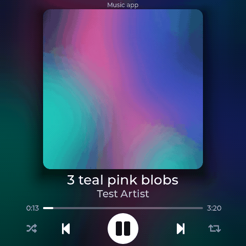
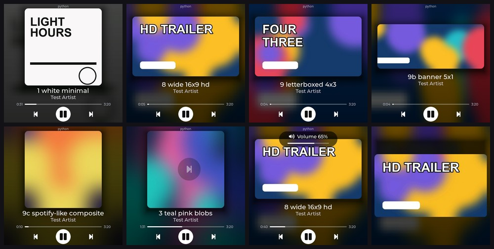
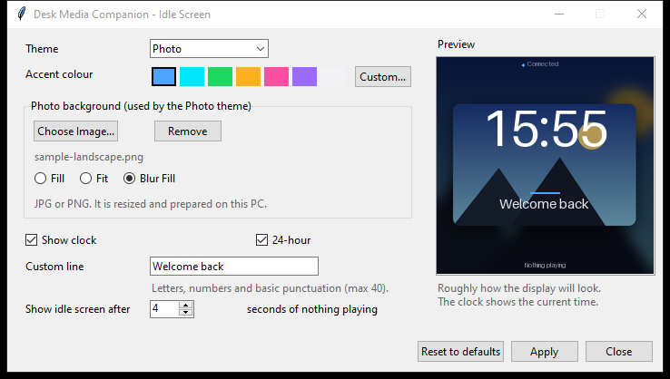
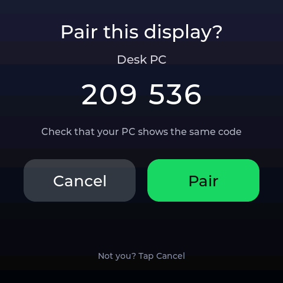
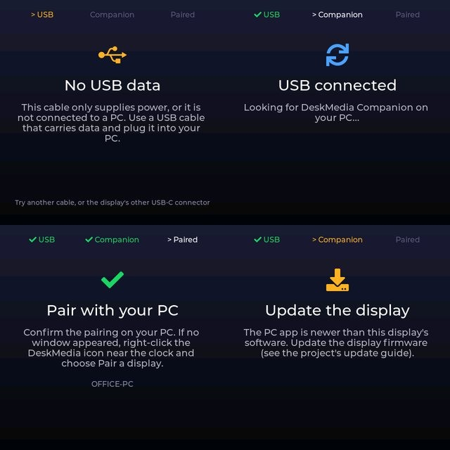
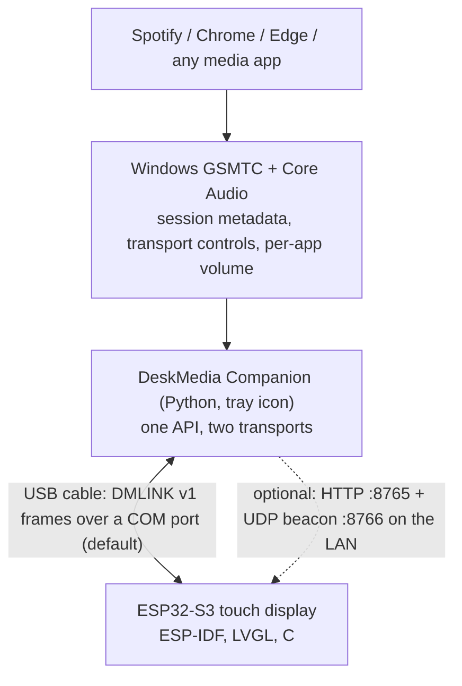

# DeskMedia Display
A standalone ESP32-S3 touchscreen media display and controller for Windows.

## Download for Windows

**[Download DeskMedia Companion for Windows](https://github.com/shayansharif532/deskmedia-display/releases/latest)** - the latest release; under **Assets** pick `DeskMediaCompanion-Setup-1.0.0.exe`.

> **Please do not download the source code.** Do not use the green **Code** button, **Download ZIP** or **Source code (zip)**: that is for
> developers and it is not the app. The one installer file on the Releases page is all you need.

1. **Plug the DeskMedia display** into a USB port of your Windows 10 / 11 PC (use a USB cable that carries data). The display says **Install DeskMedia Companion**.
2. **Download and run the installer** from the link above. If Windows says "Windows protected your PC", click **More info**, then **Run anyway** (the installer is not code-signed yet).
3. **Pair once.** The display and the PC show the same six-digit code. If they match, click **Pair** on the PC and tap **Pair** on the display.
4. **Done.** From now on just plug it in: the companion starts with Windows and the display reconnects by itself. **No Wi-Fi is needed.**

More detail: [First-time setup](#first-time-setup) and [Everyday use](#everyday-use).

## What it is

A small Windows companion reads the Windows Global System Media Transport Controls (GSMTC) and per-application audio sessions. The ESP32-S3
display is plugged into the PC with a **USB cable**, is found automatically, follows whatever is playing, shows the artwork, title and
progress on a 480x480 touchscreen, and sends your taps and swipes back as media commands. It works with Spotify, with Chrome / Edge / YouTube
and with any other app that publishes a Windows media session. No Spotify account, OAuth or Premium subscription is needed, and **no Wi-Fi
setup**: Wi-Fi / LAN is an optional fallback, off by default.

Platform: Windows 10 / 11 · Firmware: ESP-IDF 5.5.5, LVGL 9.5, C · Companion: Python 3.12 · Board: Waveshare ESP32-S3-Touch-LCD-4B

## Screenshots

Captured from the board's real LVGL frame buffer with the developer screenshot tool (`tools/screenshot.py`). All covers are synthetic test
images and the two sources are silent mock sessions; nothing here comes from a real music library or desktop.

<p align="center"></p>

*Demo (`tools/demo_capture.py`): the player with Spotify-style shuffle / repeat, a vertical swipe to another source, one more swipe onto the Idle Screen item, the Dark and Neon idle themes, and auto-follow when a session starts playing.*

| | |
|---|---|
|  |  |
| *Player: six synthetic covers; the whole background is derived from the cover* | *Artwork keeps its own shape: square, 16:9 landscape card, letterboxed 4:3 (bars trimmed), banner; the "Volume 65%" pill* |
|  |  |
| *Vertical swipe switches the media source (the pill names the source); a paused source shows its own state* | *Shuffle and repeat appear only for Spotify, through the Windows-native controls (a test session stands in for Spotify here)* |
|  |  |
| *Idle screen: Minimal, Dark, Neon, a 12-hour clock, and the Photo theme in Fill / Fit / Blur Fill* | *The idle screen is one more item of the vertical source carousel; music keeps playing behind it* |
|  |  |
| *The companion's tray Settings window, with a live preview* | *Pairing: the display and the PC show the same six-digit code; confirm on both* |

<p align="center"></p>

*Some of what the display says before it is connected (a step strip at the top shows USB - Companion - Paired): charge-only cable, looking for the companion, pair, and the firmware-update case. There are also screens for installing, updating and re-pairing the companion. They disappear by themselves once the link works.*

## Features

* **480x480 capacitive touch UI** on a 4-inch RGB panel, drawn with LVGL.
* **Artwork** from the media session, shown large; **16:9 video thumbnails as a landscape card**, never stretched; app logos and black
  letterbox bars are removed on the PC.
* **Adaptive, artwork-driven blurred background**: one pre-baked, dithered image per track.
* **Title and artist / channel, progress with seeking**, play / pause, previous / next.
* **Gestures:** horizontal swipe = previous / next track, vertical swipe = switch the media source.
* **Automatic active-player detection (auto-follow):** the display follows the session that started playing most recently, also across
  **multiple simultaneous sessions** (for example Spotify and a browser tab). A manual source choice is temporary and never disables auto-follow.
* **Spotify shuffle / repeat** through the Windows-native session controls (Spotify desktop only; no OAuth).
* **Per-application volume**, never the master volume; the two hardware side buttons are the volume keys.
* **Customizable idle screen** when nothing plays: Minimal / Dark / Neon / Photo themes, accent colour, clock (12 / 24 h), date (four formats, can be hidden), one custom line,
  a picture background with Fill / Fit / Blur Fill. Configured in the companion's tray Settings window; no reflashing.
* **The idle screen is a selectable item of the source carousel** (`Spotify <-> Chrome <-> Idle Screen`): a display choice only, media keeps playing.
* **Persistent idle image and settings** (NVS plus a dedicated flash partition): they survive reboots of the display, the companion and Windows.
* **USB-first connection**: the display talks to the companion over the USB cable (a standard serial port, Windows' own driver, no setup).
  The COM port is found automatically, also after unplugging, a reboot of either side or a new USB port ([docs/usb-protocol.md](docs/usb-protocol.md)).
* **Guided first-time setup on the display itself**: *USB connected / No USB data / Install DeskMedia Companion (it names the project's GitHub page, whose Releases hold the installer) / Pair with your PC*,
  switching to the player by itself once everything is ready; a charge-only cable is recognised.
* **Secure pairing, once**: a six-digit code confirmed on both ends, then every request is signed and the pairing is remembered on both sides
  ([docs/protocol.md](docs/protocol.md), [docs/security.md](docs/security.md)).
* **Optional Wi-Fi / LAN transport** (off by default, no firewall prompt in USB mode): UDP discovery, automatic reconnect with back-off, the same
  API and the same pairing. The firmware needs no Wi-Fi credentials to be useful.

## Architecture

```
Spotify / Chrome / Edge / media app
              ↓
Windows GSMTC + Core Audio
              ↓
DeskMedia Companion
              ↓
   USB cable (DMLINK v1)         optional: Wi-Fi / LAN
              ↓
ESP32-S3 Touch Display
```



* **GSMTC** (`Windows.Media.Control`) provides the session metadata (title, artist, artwork, timeline) and the transport controls
  (play, pause, next, previous, seek). It is the same source as the Windows media overlay and the keyboard media keys.
* **Core Audio** provides the per-application volume (the same sliders as the Volume Mixer).
* The **companion** serves one small API (about a dozen routes: now playing, artwork, controls, sources, idle-screen settings, pairing). It also
  prepares artwork, so the ESP32 only decodes ready-made images. The same API is reachable over two transports: the USB cable (**DMLINK**,
  framed requests and answers over the board's serial port; the default) and, if switched on, HTTP on the LAN.
* The **ESP32** handles the touchscreen UI and the embedded interaction: finding the companion, polling about once a second, rendering,
  gestures, side keys, and sending commands back. Every command names the session on screen, so it never reaches another app.

Details, diagrams of the device states and of the source-selection model: [docs/architecture.md](docs/architecture.md).

## Technical highlights

* **Embedded graphics.** LVGL 9.5 on an RGB ST7701 panel with PSRAM frame and image buffers, a 24 KB LVGL task pinned to its own core, one
  software draw unit (chosen after a documented touch-crash investigation), fixed PSRAM buffers allocated once, ordered-dithered RGB565 images so gradients do not band.
* **USB link.** A versioned, length-prefixed, double-checksummed frame protocol (DMLINK v1) over the ESP32-S3's native USB-Serial/JTAG port:
  streaming resynchronising parser, chunked responses up to 160 KB (artwork), presence handshake with beacons, duplicate suppression, a
  session handshake bound to the pairing key, 0 bad frames over thousands of exchanges on the real board ([docs/usb-protocol.md](docs/usb-protocol.md)).
* **ESP32 networking and resilience.** One request path for both transports, a time-scheduled 1 Hz poll that commands can never starve,
  re-detection when the cable or the companion comes and goes, and for the optional LAN mode UDP discovery, back-off reconnect and
  re-discovery when the PC's address changes; size-capped responses and bounded string copies for everything read from the link.
* **Windows integration.** GSMTC session reading and control through WinRT, and per-application volume through Core Audio sessions
  (`ISimpleAudioVolume`), verified not to touch the master volume.
* **Multi-session routing and auto-follow.** A pure, unit-tested state machine (AUTO / MANUAL_TEMP, a synthetic Idle item in the swipe ring)
  decides what the display shows; a 0.4 s watcher keeps it current; commands carry the displayed session's id and are refused if it is gone.
* **Persistent configuration.** Settings in NVS and a 1 MB dedicated `idle_img` flash partition with a header-last write, CRC re-check on load
  and fallbacks, so a power cut during a write cannot produce a broken screen.
* **Image pipeline.** On the PC: structural removal of app logos (Spotify's alpha composite is split by its alpha bands, never by a fixed crop),
  letterbox trimming, aspect-preserving rendering, edge-only halo-limited up-scaling for ~150 px browser thumbnails, baseline JPEG encoding. On the
  ESP32: JPEG decode into fixed PSRAM buffers, dithered RGB565 conversion and a per-track blurred background baked in ~100-400 ms.
* **Authenticated pairing protocol.** X25519 key agreement with a commitment and a six-digit comparison code, HKDF key derivation, HMAC-SHA256
  signed requests with single-use nonces (replay protection) and signed responses ([docs/protocol.md](docs/protocol.md)).
* **Verification.** Unit tests for the pure logic, isolated end-to-end tests against the real Windows media API with silent fake sessions,
  board-in-the-loop tests with a virtual finger and simulated key presses, and heap / stack soak runs that checked for resets and leaks.

## Hardware

| | |
|---|---|
| **Reference board** | **Waveshare ESP32-S3-Touch-LCD-4B** (SKU 32052, "Smart 86 Box") |
| Module | ESP32-S3-WROOM-1-N16R8: dual-core 240 MHz, 16 MB flash, 8 MB octal PSRAM, Wi-Fi 4 (2.4 GHz) + BLE |
| Display | 4-inch 480x480 IPS, ST7701 on a 16-bit parallel RGB bus |
| Touch | GT911 5-point capacitive |
| Buttons | BOOT (GPIO0) and PWR (read from the AXP2101 power chip over I2C); used as volume down / up |
| USB | two USB-C connectors: the **native USB-Serial/JTAG** one carries the link to the PC (and flashing); the second one is a UART bridge for the firmware console |

This board is the **only board currently supported**: the pin map, the panel initialisation and the button handling are specific to it, and
nothing in the firmware has been tried on another board. Pin map and sources: [docs/hardware.md](docs/hardware.md).

## Software stack

| Part | Stack |
|---|---|
| Firmware | ESP-IDF 5.5.5, LVGL 9.5.0 (via `esp_lvgl_port`), C on FreeRTOS, the Waveshare board support package 2.0.0, `esp_jpeg`; versions pinned in `firmware/dependencies.lock` |
| Windows companion | Python 3.12, WinRT bindings (`winrt-Windows.Media.Control`) for GSMTC, `pycaw` / `comtypes` for Core Audio, `pyserial` (the USB link), Pillow (artwork), `psutil` (network interfaces), `pystray` and `tkinter` (tray icon and windows), the standard library's HTTP server and UDP sockets (optional LAN mode); packaged with PyInstaller, installed with an Inno Setup per-user installer |
| Tools | PowerShell wrappers (`tools/idf.ps1`), esptool, pyserial, Python test and screenshot tools |

## Controls

| Gesture | Action |
|---|---|
| Swipe left | next track |
| Swipe right | previous track |
| Swipe up / down | switch the media source: the next / previous media session (playing or paused), including the idle screen item; wraps around |
| Tap the artwork | full-screen artwork (tap again to return) |
| Drag on the progress bar | seek |
| Upper side button (PWR) / lower side button (BOOT) | volume up / down of the application shown (5 % per press, hold to repeat) |
| Shuffle / repeat buttons | Spotify only: shuffle toggle, repeat off / playlist / track |

A swipe needs at least 72 px of mostly straight travel; a diagonal drag does nothing. While the idle screen is shown, horizontal swipes and the
volume keys do nothing, so no unrelated app can be changed by accident. Do not hold the upper (PWR) button for more than about four seconds:
the power chip turns the board off by itself.

## Customizable idle screen

When nothing has played for a configurable time (default 4 s, 2-60 s) the display shows its idle screen; anything that starts playing brings the
player back at once.

* **Themes:** Minimal (near-black), Dark (soft gradient, the default), Neon (violet gradient with an accent glow), Photo (your own picture).
* **Background picture:** JPG or PNG with **Fill**, **Fit** or **Blur Fill**. The picture is validated, resized and prepared on the PC (exactly
  480x480, baseline JPEG up to 200 KB); the display never receives your original.
* **Clock:** large digital clock, 12 or 24 hour, from the PC's local time.
* **Custom text** (one line), **accent colour** and **delay**.
* Edited in the companion's tray **Settings** window with a live preview. Nothing can change the settings over the network. Settings are
  cached on the display, so a reboot needs no transfer.

## First-time setup

For somebody who has been handed a display (a Windows 10 / 11 PC, 64-bit; no Python, no administrator account, no Wi-Fi setup and no source code needed;
the longer version with every screen of the display is in [docs/installation.md](docs/installation.md)):

1. **Plug the display into a USB port of the PC** with a data cable. It is found automatically. Until everything is ready it tells you what is
   missing: *No USB data* (charge-only cable or no PC: use a data cable or the board's other USB-C connector), *Install DeskMedia
   Companion* (step 2), *Pair with your PC* (step 3).
2. **Install the companion.** Open the project's [Releases page](https://github.com/shayansharif532/deskmedia-display/releases/latest) and download `DeskMediaCompanion-Setup-1.0.0.exe` (the display prints the same
   address). Run it: it installs just for you; if Windows says "protected your PC", click *More info > Run anyway* (the installer is not code-signed). Leave *Start with Windows*
   ticked and finish with *Start now*; a small icon appears next to the clock.
3. **Pair once.** The display and a window on the PC show the same six-digit code. If they match, confirm on the PC (**Pair**) and on the
   display. This is remembered on both sides.
4. **Done.** Play something: title, artist, artwork and progress appear; taps, swipes and the side buttons control the player.

## Everyday use

**Plug in. That is all.** The companion starts with Windows (the icon next to the clock), the display finds it within a few seconds after being
plugged in, powered up, or after the PC wakes or restarts, and no pairing is asked again. The icon's menu has the status of the display, the
**idle-screen settings** (themes, 12 / 24 h clock, date format or hidden, your own picture), **Pair a display...** / **Forget paired display**
(only needed to move the display to another PC or after a reset), **Start with Windows**, **Open log folder**, **About** (versions) and **Exit**.
Updating the companion = run the newer installer (settings and pairing are kept); updating the display's firmware: [docs/updating.md](docs/updating.md).
Something wrong: [docs/troubleshooting.md](docs/troubleshooting.md).

## Building from source

Full instructions: [docs/development.md](docs/development.md). In short, on Windows with ESP-IDF 5.5.5, Python 3.12 and a Waveshare ESP32-S3-Touch-LCD-4B:

1. **Build and flash the firmware.** `.\tools\idf.ps1 set-target esp32s3`, `.\tools\idf.ps1 build` and `.\tools\idf.ps1 -p <port> flash` (the product
   firmware needs **no** Wi-Fi settings; an optional LAN fallback for development reads the git-ignored `firmware/secrets.local.h`, made by
   `tools\set-dev-secrets.ps1`). Take a backup of the board's factory flash first
   ([docs/development-history/M0-factory-backup.md](docs/development-history/M0-factory-backup.md)).
2. **Run the companion:** `python -m desk_media_companion --console` from `companion/` (see [companion/README.md](companion/README.md)); USB is the default and opens no
   network port. Build the installer with `tools\build_release.ps1` ([installer/README.md](installer/README.md)).
3. **Pair the display:** it opens a pairing window by itself when an unpaired display is plugged in (or: tray menu **Pair a display...**); compare the six-digit code on the PC and on the display and confirm on both.

## Security

The display and the companion pair once with a six-digit code that both ends show; afterwards every request is signed, replays are rejected,
and the companion's answers are signed too. Over the **USB cable** nothing is exposed to a network at all and each connection additionally
proves possession of the pairing key (a mutual challenge-response) before any private route is served. The optional **LAN** mode is served only
to private, loopback and link-local clients, is authenticated but **not encrypted** (plain HTTP), and is off by default. See
[docs/security.md](docs/security.md) for the threat model and [docs/protocol.md](docs/protocol.md) and [docs/usb-protocol.md](docs/usb-protocol.md)
for the byte-level protocols. No credentials of any online service exist anywhere in the project.

## Limitations

* **Windows only:** the companion uses the Windows media-session and Core Audio APIs.
* **One reference board:** only the Waveshare ESP32-S3-Touch-LCD-4B is supported.
* **Browser artwork is soft.** Chromium browsers hand Windows only a ~150 px thumbnail, so 16:9 covers from YouTube are enlarged and look soft;
  Windows offers no larger image. Spotify covers are sharp.
* **Browser volume is per browser, not per tab:** all tabs share one audio session, so the whole browser's volume changes; Firefox cannot be matched.
* **Fonts:** the UI fonts are ASCII Montserrat. Titles with accented letters, CJK, Cyrillic or emoji show missing glyphs until a fallback font is added. The idle screen's custom line is simplified to ASCII on the PC.
* **USB needs a data cable** between the display and the PC (a charge-only cable is recognised: the display says *No USB data*); the PC must be
  on and the companion running (it starts with Windows).
* **The optional Wi-Fi / LAN mode is a developer fallback and is not re-verified after the USB changes** (see Project status): Wi-Fi credentials are compile-time configuration (`firmware/secrets.local.h`), there is no
  provisioning portal, and the LAN API is authenticated but not encrypted (plain HTTP).
* **The installer is not code-signed** (Windows SmartScreen asks once). The *Install DeskMedia Companion* screen prints the project's GitHub address
  (`DM_SETUP_ADDRESS`, changeable at build time; [docs/installation.md](docs/installation.md)).
* Shuffle / repeat exist for the Spotify desktop app only (the web player is just a browser tab to Windows).

## Project status

**Stable** (hardware-tested on the reference board with the test tools, with real Spotify desktop and Chrome / YouTube sessions in the early milestones):

* Now-playing display, artwork, progress, play / pause / previous / next / seek, per-application volume, source switching, auto-follow, Spotify
  shuffle / repeat, the idle screen with its themes and picture persistence, and the idle item in the carousel.
* The USB link (framed protocol, automatic discovery, session authentication): hardware-tested with the board and the real companion code over the cable, with Wi-Fi switched off:
  discovery without a port setting, pairing once, restart of the companion and reboot of the display reconnect without pairing again,
  the idle screen including the date (four formats, hide, midnight rollover on the device) after reboots and restarts ([docs/acceptance-tests.md](docs/acceptance-tests.md)).
* The optional Wi-Fi transport: recovery (a deliberately dropped link recovered in about 2 s) and PC re-discovery were tested before the USB link existed. It is **not re-verified after the USB changes.** See [docs/acceptance-tests.md](docs/acceptance-tests.md).
* Soak runs without a reset or heap / stack drift: 24 real touches over 941 s; five-minute gesture soaks (about 115-125 scripted actions);
  30 idle <-> playback cycles over 315 s; 40 idle-carousel cycles.
* Details and evidence: [docs/development-history/](docs/development-history/README.md).

**Not yet verified by a person:** unplugging and re-plugging the cable with the companion running, a charge-only cable, a PC reboot, the BOOT-held download-mode recovery, the installer's wizard on a clean machine
(the silent install, upgrade and uninstall paths are tested), and the setup screens and the idle date on the glass: the list with exact steps is [docs/acceptance-tests.md](docs/acceptance-tests.md).

**Known limitations:** see above. In addition, gestures, the side buttons and the idle-screen fades were mostly checked through the board's virtual finger
and simulated key presses (the same LVGL input path as the touch controller); a physical check of the upper (PWR) side button and of how the idle screen
looks on the glass was still open in the logs. A short screen flicker while a *new* idle picture is written to flash is possible and not verified.

**Future work:**

* Full-screen artwork polish (the full-screen cover is the 312 px image enlarged, so it is soft).
* Optional Wi-Fi provisioning for the LAN fallback (over the USB link, or a setup access point); the product no longer needs Wi-Fi.
* A code-signed installer and a firmware flasher for recipients (today: the installer is unsigned and the firmware is flashed with `esptool`, [docs/updating.md](docs/updating.md)).
* Fallback fonts for non-ASCII titles.
* A targeted touch stress soak (top band, screen edges, rapid taps).
* Optional, not started: a browser extension for high-resolution browser artwork (analysis in [M8c](docs/development-history/M8c-session-switching.md)); an enclosure and stand.

## Repository layout

```
README.md             this page
PORTFOLIO.md          short project summary for CVs and portfolios
CLAUDE.md             orientation for contributors and AI assistants (rules and pitfalls)
THIRD_PARTY_NOTICES.md, LICENSES/   third-party licences and credits
companion/            the Windows companion (Python): desk_media_companion/, tests/, tools/ (a simulated display), build.ps1
firmware/             the ESP-IDF project: main/, components/{ui, usb_link, wifi_mgr, pc_media, idle_screen, side_keys}, partitions.csv
installer/            the per-user Windows installer (Inno Setup) and its assets
tools/                idf.ps1, find-board.ps1, build_release.ps1, package_firmware.ps1, board-in-the-loop tests (usb_test.py, idle_test.py, ...)
docs/                 architecture, protocols, security, hardware, installation, updating, troubleshooting, development guide, decisions/, development-history/, screenshots/
backup/               where your own factory flash backup goes (*.bin is git-ignored)
```

## Documentation

| Document | Content |
|---|---|
| [docs/architecture.md](docs/architecture.md) | System overview, components, data flow, device states, source-selection model, threading, memory, persistence |
| [docs/protocol.md](docs/protocol.md) | The API and pairing, authenticated LAN requests, the HTTP transport |
| [docs/usb-protocol.md](docs/usb-protocol.md) | DMLINK v1: the USB link (frames, presence, session, limits, test vectors) |
| [docs/security.md](docs/security.md) | Threat model, the USB trust model, the post-change security review |
| [docs/installation.md](docs/installation.md), [docs/updating.md](docs/updating.md), [docs/troubleshooting.md](docs/troubleshooting.md) | First-time setup and everyday use; updating the companion and the firmware; what each setup screen means and how to recover |
| [docs/idle-screen.md](docs/idle-screen.md) | The idle screen: clock, date formats, where the time comes from, the layout contract |
| [docs/acceptance-tests.md](docs/acceptance-tests.md) | What is automated, and the physical tests that need a person |
| [docs/hardware.md](docs/hardware.md) | The reference board: silicon, peripherals, pin map, side buttons, sources |
| [docs/development.md](docs/development.md) | Set up a machine, build, flash, run, package, test, troubleshoot |
| [docs/decisions/](docs/decisions/README.md) | Architecture decision records (ADR-001 ... ADR-009; ADR-009 is why the link is USB) |
| [docs/development-history/](docs/development-history/README.md) | The engineering logs of how the project was built, milestone by milestone |
| [companion/README.md](companion/README.md) | Companion usage, options, data locations |
| [docs/licensing.md](docs/licensing.md), [THIRD_PARTY_NOTICES.md](THIRD_PARTY_NOTICES.md) | Licensing status and third-party notices |

## Contributing / development

Start with [docs/development.md](docs/development.md) (setup, build, test tools and their safety rules) and [CLAUDE.md](CLAUDE.md) (project rules,
flashing safety, secret handling, pitfalls). Keep commits small and verified, never commit secrets, flash dumps or non-synthetic images, and record
design decisions as ADRs in [docs/decisions/](docs/decisions/README.md).

## License

Licence not yet chosen - see [docs/licensing.md](docs/licensing.md). Third-party components keep their own licences:
[THIRD_PARTY_NOTICES.md](THIRD_PARTY_NOTICES.md).

DeskMedia Display is an unofficial hobby project, not affiliated with or endorsed by Spotify, Google, Microsoft, Waveshare, Espressif or LVGL.
