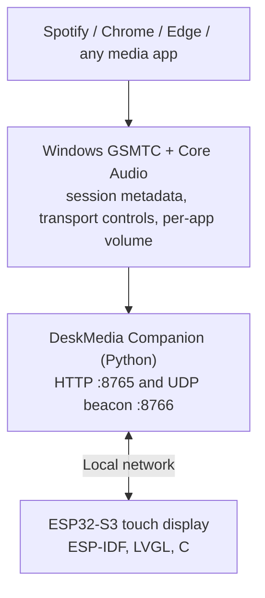

# DeskMedia Display
A standalone ESP32-S3 touchscreen media display and controller for Windows.

A small Windows companion reads the Windows Global System Media Transport Controls (GSMTC) and per-application audio sessions. The ESP32-S3
display finds it on the local network, follows whatever is playing, shows the artwork, title and progress on a 480x480 touchscreen, and sends
your taps and swipes back as media commands. It works with Spotify, with Chrome / Edge / YouTube and with any other app that publishes a
Windows media session. No Spotify account, OAuth or Premium subscription is needed.

Platform: Windows 10 / 11 · Firmware: ESP-IDF 5.5.5, LVGL 9.5, C · Companion: Python 3.12 · Board: Waveshare ESP32-S3-Touch-LCD-4B

## Screenshots

Captured from the board's real LVGL frame buffer with the developer screenshot tool (`tools/screenshot.py`). All covers are synthetic test
images and the two sources are silent mock sessions; nothing here comes from a real music library or desktop.

<p align="center"></p>

*Demo (`tools/demo_capture.py`): the player with Spotify-style shuffle / repeat, a vertical swipe to another source, one more swipe onto the Idle Screen item, the Dark and Neon idle themes, and auto-follow when a session starts playing.*

| | |
|---|---|
|  |  |
| *Player: six synthetic covers; the whole background is derived from the cover* | *Artwork keeps its own shape: square, 16:9 landscape card, letterboxed 4:3 (bars trimmed), banner; the "Volume 65%" pill* |
|  |  |
| *Vertical swipe switches the media source (the pill names the source); a paused source shows its own state* | *Shuffle and repeat appear only for Spotify, through the Windows-native controls (a test session stands in for Spotify here)* |
|  |  |
| *Idle screen: Minimal, Dark, Neon, a 12-hour clock, and the Photo theme in Fill / Fit / Blur Fill* | *The idle screen is one more item of the vertical source carousel; music keeps playing behind it* |
|  |  |
| *The companion's tray Settings window, with a live preview* | *Pairing: the display and the PC show the same six-digit code; confirm on both* |

## Features

* **480x480 capacitive touch UI** on a 4-inch RGB panel, drawn with LVGL.
* **Artwork** from the media session, shown large; **16:9 video thumbnails as a landscape card**, never stretched; app logos and black
  letterbox bars are removed on the PC.
* **Adaptive, artwork-driven blurred background**: one pre-baked, dithered image per track.
* **Title and artist / channel, progress with seeking**, play / pause, previous / next.
* **Gestures:** horizontal swipe = previous / next track, vertical swipe = switch the media source.
* **Automatic active-player detection (auto-follow):** the display follows the session that started playing most recently, also across
  **multiple simultaneous sessions** (for example Spotify and a browser tab). A manual source choice is temporary and never disables auto-follow.
* **Spotify shuffle / repeat** through the Windows-native session controls (Spotify desktop only; no OAuth).
* **Per-application volume**, never the master volume; the two hardware side buttons are the volume keys.
* **Customizable idle screen** when nothing plays: Minimal / Dark / Neon / Photo themes, accent colour, clock (12 / 24 h), date (four formats, can be hidden), one custom line,
  a picture background with Fill / Fit / Blur Fill. Configured in the companion's tray Settings window; no reflashing.
* **The idle screen is a selectable item of the source carousel** (`Spotify <-> Chrome <-> Idle Screen`): a display choice only, media keeps playing.
* **Persistent idle image and settings** (NVS plus a dedicated flash partition): they survive reboots of the display, the companion and Windows.
* **Automatic PC discovery** over the LAN (UDP beacon); the PC's address may change.
* **Wi-Fi reconnect and recovery**: exponential back-off; the display keeps retrying and says "Can't reach your PC" while the PC is away.
* **Secure pairing and authenticated requests**: a six-digit code confirmed on both ends, then signed requests ([docs/protocol.md](docs/protocol.md)).

## Architecture

```
Spotify / Chrome / Edge / media app
              ↓
Windows GSMTC + Core Audio
              ↓
DeskMedia Companion
              ↓
       Local network
              ↓
ESP32-S3 Touch Display
```



* **GSMTC** (`Windows.Media.Control`) provides the session metadata (title, artist, artwork, timeline) and the transport controls
  (play, pause, next, previous, seek). It is the same source as the Windows media overlay and the keyboard media keys.
* **Core Audio** provides the per-application volume (the same sliders as the Volume Mixer).
* The **companion** exposes a small local protocol: an HTTP API plus a UDP discovery beacon. It also prepares artwork, so the ESP32 only decodes ready-made images.
* The **ESP32** handles the touchscreen UI and the embedded interaction: discovery, polling about once a second, rendering, gestures, side keys,
  and sending commands back. Every command names the session on screen, so it never reaches another app.

Details, diagrams of the device states and of the source-selection model: [docs/architecture.md](docs/architecture.md).

## Technical highlights

* **Embedded graphics.** LVGL 9.5 on an RGB ST7701 panel with PSRAM frame and image buffers, a 24 KB LVGL task pinned to its own core, one
  software draw unit (chosen after a documented touch-crash investigation), fixed PSRAM buffers allocated once, ordered-dithered RGB565 images so gradients do not band.
* **ESP32 networking and resilience.** UDP beacon discovery, a time-scheduled 1 Hz poll over a kept-alive HTTP connection that commands can never
  starve, back-off reconnect, re-discovery when the PC's address changes, size-capped responses and bounded string copies for everything read from the network.
* **Windows integration.** GSMTC session reading and control through WinRT, and per-application volume through Core Audio sessions
  (`ISimpleAudioVolume`), verified not to touch the master volume.
* **Multi-session routing and auto-follow.** A pure, unit-tested state machine (AUTO / MANUAL_TEMP, a synthetic Idle item in the swipe ring)
  decides what the display shows; a 0.4 s watcher keeps it current; commands carry the displayed session's id and are refused if it is gone.
* **Persistent configuration.** Settings in NVS and a 1 MB dedicated `idle_img` flash partition with a header-last write, CRC re-check on load
  and fallbacks, so a power cut during a write cannot produce a broken screen.
* **Image pipeline.** On the PC: structural removal of app logos (Spotify's alpha composite is split by its alpha bands, never by a fixed crop),
  letterbox trimming, aspect-preserving rendering, edge-only halo-limited up-scaling for ~150 px browser thumbnails, baseline JPEG encoding. On the
  ESP32: JPEG decode into fixed PSRAM buffers, dithered RGB565 conversion and a per-track blurred background baked in ~100-400 ms.
* **Authenticated pairing protocol.** X25519 key agreement with a commitment and a six-digit comparison code, HKDF key derivation, HMAC-SHA256
  signed requests with single-use nonces (replay protection) and signed responses ([docs/protocol.md](docs/protocol.md)).
* **Verification.** Unit tests for the pure logic, isolated end-to-end tests against the real Windows media API with silent fake sessions,
  board-in-the-loop tests with a virtual finger and simulated key presses, and heap / stack soak runs that checked for resets and leaks.

## Hardware

| | |
|---|---|
| **Reference board** | **Waveshare ESP32-S3-Touch-LCD-4B** (SKU 32052, "Smart 86 Box") |
| Module | ESP32-S3-WROOM-1-N16R8: dual-core 240 MHz, 16 MB flash, 8 MB octal PSRAM, Wi-Fi 4 (2.4 GHz) + BLE |
| Display | 4-inch 480x480 IPS, ST7701 on a 16-bit parallel RGB bus |
| Touch | GT911 5-point capacitive |
| Buttons | BOOT (GPIO0) and PWR (read from the AXP2101 power chip over I2C); used as volume down / up |
| USB | native USB-Serial/JTAG for flashing and logs |

This board is the **only board currently supported**: the pin map, the panel initialisation and the button handling are specific to it, and
nothing in the firmware has been tried on another board. Pin map and sources: [docs/hardware.md](docs/hardware.md).

## Software stack

| Part | Stack |
|---|---|
| Firmware | ESP-IDF 5.5.5, LVGL 9.5.0 (via `esp_lvgl_port`), C on FreeRTOS, the Waveshare board support package 2.0.0, `esp_jpeg`; versions pinned in `firmware/dependencies.lock` |
| Windows companion | Python 3.12, WinRT bindings (`winrt-Windows.Media.Control`) for GSMTC, `pycaw` / `comtypes` for Core Audio, Pillow (artwork), `psutil` (network interfaces), `pystray` and `tkinter` (tray icon and settings window), the standard library's HTTP server and UDP sockets; packaged with PyInstaller |
| Tools | PowerShell wrappers (`tools/idf.ps1`), esptool, pyserial, Python test and screenshot tools |

## Controls

| Gesture | Action |
|---|---|
| Swipe left | next track |
| Swipe right | previous track |
| Swipe up / down | switch the media source: the next / previous media session (playing or paused), including the idle screen item; wraps around |
| Tap the artwork | full-screen artwork (tap again to return) |
| Drag on the progress bar | seek |
| Upper side button (PWR) / lower side button (BOOT) | volume up / down of the application shown (5 % per press, hold to repeat) |
| Shuffle / repeat buttons | Spotify only: shuffle toggle, repeat off / playlist / track |

A swipe needs at least 72 px of mostly straight travel; a diagonal drag does nothing. While the idle screen is shown, horizontal swipes and the
volume keys do nothing, so no unrelated app can be changed by accident. Do not hold the upper (PWR) button for more than about four seconds:
the power chip turns the board off by itself.

## Customizable idle screen

When nothing has played for a configurable time (default 4 s, 2-60 s) the display shows its idle screen; anything that starts playing brings the
player back at once.

* **Themes:** Minimal (near-black), Dark (soft gradient, the default), Neon (violet gradient with an accent glow), Photo (your own picture).
* **Background picture:** JPG or PNG with **Fill**, **Fit** or **Blur Fill**. The picture is validated, resized and prepared on the PC (exactly
  480x480, baseline JPEG up to 200 KB); the display never receives your original.
* **Clock:** large digital clock, 12 or 24 hour, from the PC's local time.
* **Custom text** (one line), **accent colour** and **delay**.
* Edited in the companion's tray **Settings** window with a live preview. Nothing can change the settings over the network. Settings are
  cached on the display, so a reboot needs no transfer.

## Getting started

Full instructions: [docs/development.md](docs/development.md). In short, on Windows with ESP-IDF 5.5.5, Python 3.12 and a Waveshare ESP32-S3-Touch-LCD-4B:

1. **Build and flash the firmware.** Write your Wi-Fi settings into the git-ignored `firmware/secrets.local.h` (`tools\set-dev-secrets.ps1`),
   then `.\tools\idf.ps1 set-target esp32s3`, `.\tools\idf.ps1 build` and `.\tools\idf.ps1 -p <port> flash`. Take a backup of the board's factory flash first
   ([docs/development-history/M0-factory-backup.md](docs/development-history/M0-factory-backup.md)).
2. **Run the companion:** `python -m desk_media_companion --console` from `companion/` (see [companion/README.md](companion/README.md)), or build the single exe with
   `companion\build.ps1`. Allow it through the Windows Firewall when asked.
3. **Pair the display:** in the companion's tray menu choose **Pair a display...**, compare the six-digit code on the PC and on the display and confirm on both.

## Security

The display and the companion pair once with a six-digit code that both ends show; afterwards every request is signed, replays are rejected,
and the companion's answers are signed too. The API is served only to the local network (private, loopback and link-local clients). It is
authenticated but **not encrypted** (plain HTTP on the LAN). See [docs/security.md](docs/security.md) for the threat model and
[docs/protocol.md](docs/protocol.md) for the byte-level protocol. No credentials of any online service exist anywhere in the project.

## Limitations

* **Windows only:** the companion uses the Windows media-session and Core Audio APIs.
* **One reference board:** only the Waveshare ESP32-S3-Touch-LCD-4B is supported.
* **Browser artwork is soft.** Chromium browsers hand Windows only a ~150 px thumbnail, so 16:9 covers from YouTube are enlarged and look soft;
  Windows offers no larger image. Spotify covers are sharp.
* **Browser volume is per browser, not per tab:** all tabs share one audio session, so the whole browser's volume changes; Firefox cannot be matched.
* **Fonts:** the UI fonts are ASCII Montserrat. Titles with accented letters, CJK, Cyrillic or emoji show missing glyphs until a fallback font is added. The idle screen's custom line is simplified to ASCII on the PC.
* **Wi-Fi credentials are compile-time development configuration** (`firmware/secrets.local.h`). There is no first-run provisioning portal yet.
* **Plain HTTP on the LAN:** authenticated after pairing, not encrypted.
* The PC must be on, on the same network (no client isolation) and running the companion.
* Shuffle / repeat exist for the Spotify desktop app only (the web player is just a browser tab to Windows).

## Project status

**Stable** (hardware-tested on the reference board with the test tools, with real Spotify desktop and Chrome / YouTube sessions in the early milestones):

* Now-playing display, artwork, progress, play / pause / previous / next / seek, per-application volume, source switching, auto-follow, Spotify
  shuffle / repeat, the idle screen with its themes and picture persistence, and the idle item in the carousel.
* Wi-Fi recovery (a deliberately dropped link recovered in about 2 s) and PC re-discovery.
* Soak runs without a reset or heap / stack drift: 24 real touches over 941 s; five-minute gesture soaks (about 115-125 scripted actions);
  30 idle <-> playback cycles over 315 s; 40 idle-carousel cycles.
* Details and evidence: [docs/development-history/](docs/development-history/README.md).

**Known limitations:** see above. In addition, gestures, the side buttons and the idle-screen fades were mostly checked through the board's virtual finger
and simulated key presses (the same LVGL input path as the touch controller); a physical check of the upper (PWR) side button and of how the idle screen
looks on the glass was still open in the logs. A short screen flicker while a *new* idle picture is written to flash is possible and not verified.

**Future work:**

* Full-screen artwork polish (the full-screen cover is the 312 px image enlarged, so it is soft).
* First-run Wi-Fi provisioning (setup access point and captive page; the reset gesture would be a long press of BOOT while running).
* Companion installer: a proper installer with a one-click Windows Firewall helper and an update path (the single exe and per-user auto-start already exist).
* Fallback fonts for non-ASCII titles.
* A targeted touch stress soak (top band, screen edges, rapid taps).
* Optional, not started: a browser extension for high-resolution browser artwork (analysis in [M8c](docs/development-history/M8c-session-switching.md)); an enclosure and stand.

## Repository layout

```
README.md             this page
PORTFOLIO.md          short project summary for CVs and portfolios
CLAUDE.md             orientation for contributors and AI assistants (rules and pitfalls)
THIRD_PARTY_NOTICES.md, LICENSES/   third-party licences and credits
companion/            the Windows companion (Python): desk_media_companion/, tests/, tools/, build.ps1
firmware/             the ESP-IDF project: main/, components/{ui, wifi_mgr, pc_media, idle_screen, side_keys}, partitions.csv
tools/                idf.ps1, find-board.ps1, serial_capture.py, board-in-the-loop test and screenshot tools
docs/                 architecture, protocol, security, hardware, development guide, decisions/, development-history/, screenshots/
backup/               where your own factory flash backup goes (*.bin is git-ignored)
```

## Documentation

| Document | Content |
|---|---|
| [docs/architecture.md](docs/architecture.md) | System overview, components, data flow, device states, source-selection model, threading, memory, persistence |
| [docs/protocol.md](docs/protocol.md) | The companion <-> display protocol: beacon, pairing, authenticated requests, HTTP API |
| [docs/security.md](docs/security.md) | Threat model and security design |
| [docs/hardware.md](docs/hardware.md) | The reference board: silicon, peripherals, pin map, side buttons, sources |
| [docs/development.md](docs/development.md) | Set up a machine, build, flash, run, package, test, troubleshoot |
| [docs/decisions/](docs/decisions/README.md) | Architecture decision records (ADR-001 ... ADR-008) |
| [docs/development-history/](docs/development-history/README.md) | The engineering logs of how the project was built, milestone by milestone |
| [companion/README.md](companion/README.md) | Companion usage, options, data locations |
| [docs/licensing.md](docs/licensing.md), [THIRD_PARTY_NOTICES.md](THIRD_PARTY_NOTICES.md) | Licensing status and third-party notices |

## Contributing / development

Start with [docs/development.md](docs/development.md) (setup, build, test tools and their safety rules) and [CLAUDE.md](CLAUDE.md) (project rules,
flashing safety, secret handling, pitfalls). Keep commits small and verified, never commit secrets, flash dumps or non-synthetic images, and record
design decisions as ADRs in [docs/decisions/](docs/decisions/README.md).

## License

Licence not yet chosen - see [docs/licensing.md](docs/licensing.md). Third-party components keep their own licences:
[THIRD_PARTY_NOTICES.md](THIRD_PARTY_NOTICES.md).

DeskMedia Display is an unofficial hobby project, not affiliated with or endorsed by Spotify, Google, Microsoft, Waveshare, Espressif or LVGL.
