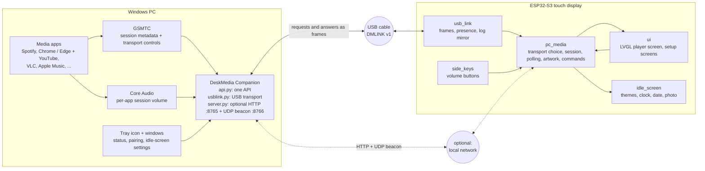
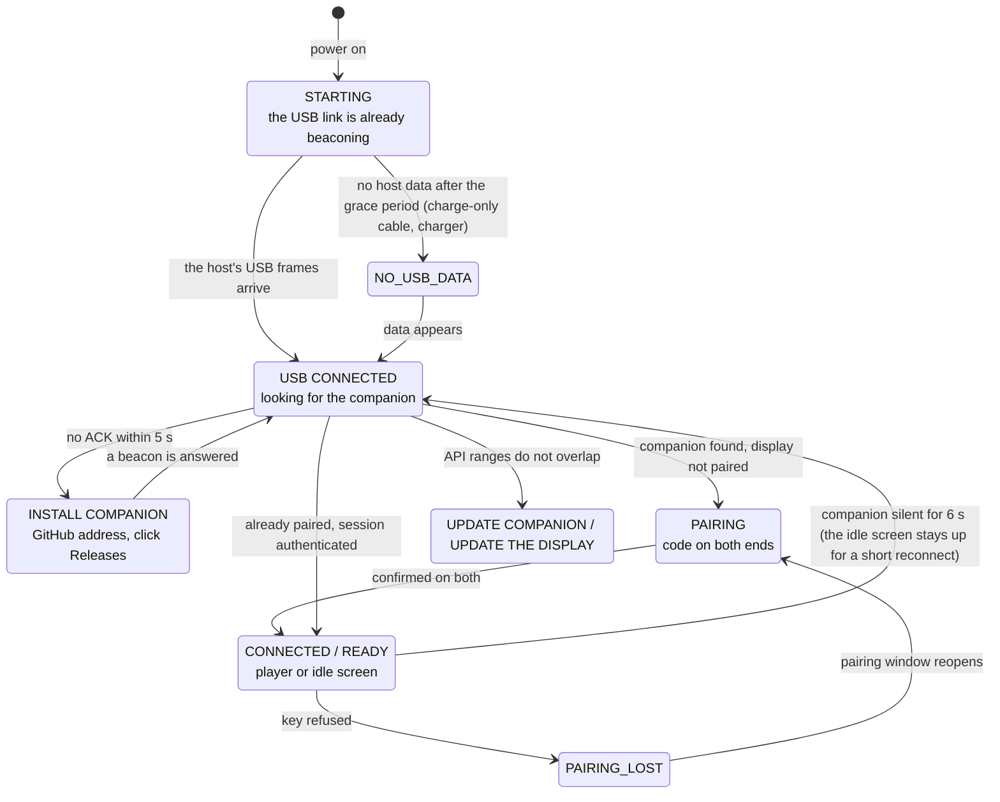
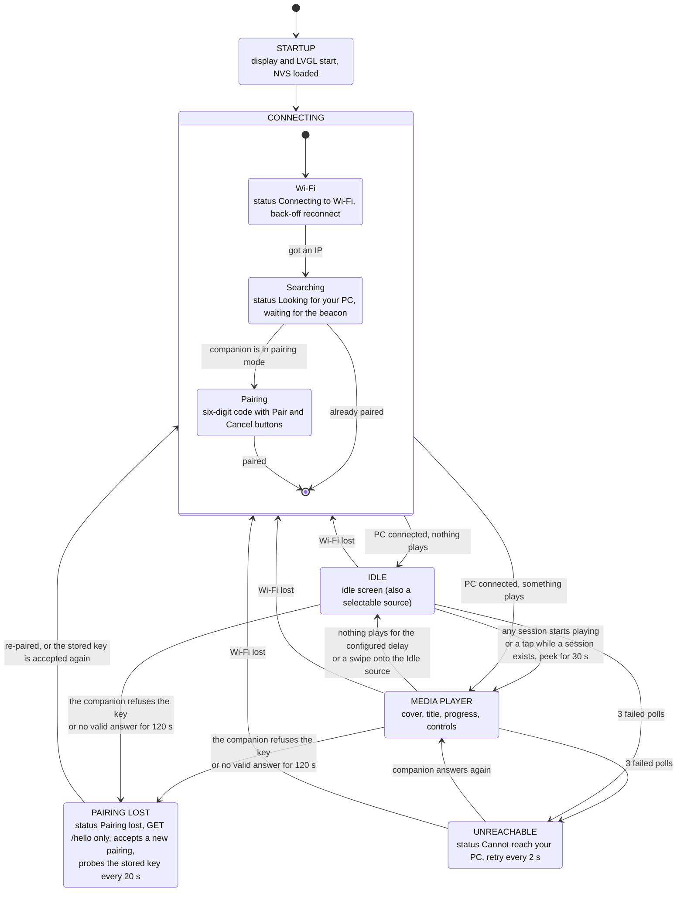
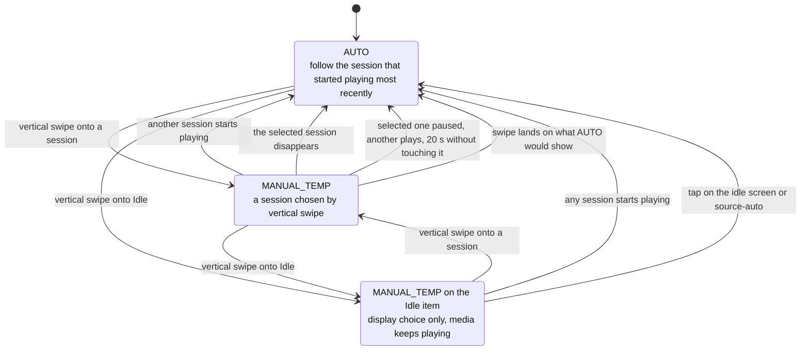

# Architecture

Design status: current. The earlier Spotify-Web-API architecture is obsolete ([ADR-003](decisions/ADR-003-windows-media-session-companion.md));
its client was removed from the tree and lives in git history under the tag `legacy-spotify-web-api`.

Related documents: [protocol.md](protocol.md) (the byte-level companion <-> display contract, pairing and request authentication),
[security.md](security.md) (threat model), [hardware.md](hardware.md) (board facts and pin map), [decisions/](decisions/README.md)
(why things are the way they are), [development.md](development.md) (build, flash, test).

## System overview

A standalone touchscreen on the desk shows and controls whatever a Windows PC is playing. The PC never streams audio or video to the
display: it only describes what is playing (title, artist, progress, a cover image) and accepts commands.

* A small **Windows companion** reads the PC's active *media sessions* through the Windows Global System Media Transport Controls
  (GSMTC, `Windows.Media.Control`: the same source as the media overlay and the media keys). Every app that publishes system media
  controls is covered: Spotify desktop, YouTube / YouTube Music in Chrome or Edge, VLC, Apple Music, ... Per-application volume comes
  from the Windows Core Audio session API.
* The companion serves that as **one small API** (`api.py`: about a dozen routes, [protocol.md](protocol.md)) over two interchangeable
  transports: the **USB cable** (DMLINK v1 frames over the board's COM port, [usb-protocol.md](usb-protocol.md); the default and the product's
  way of working) and, only when switched on, **HTTP on the local network** announced with a UDP beacon.
* The **ESP32-S3** finds the companion by itself (it hears a USB BEACON frame answered, or on the LAN a UDP beacon), polls it about once a
  second, draws the 480x480 LVGL UI and sends play / pause / next / previous / seek / volume / source-switch commands back.
* No Spotify account, Client ID, Premium subscription, OAuth, tokens or internet access is involved. Display and companion pair once
  (a six-digit code confirmed on both ends); the pairing is remembered on both sides, every LAN request is signed, and every USB connection
  proves the key first ([protocol.md](protocol.md), [usb-protocol.md](usb-protocol.md) section 4).
* No Wi-Fi is needed: the display's firmware has no credentials in the product configuration ([ADR-009](decisions/ADR-009-usb-first-transport.md)).

```
 Spotify / Chrome / Edge / any media app
                  |
                  v
   Windows GSMTC  +  Windows Core Audio
   (session metadata, transport controls)   (per-application volume)
                  |
                  v
          DeskMedia Companion  (Python, tray icon)
          one API  --  USB link (COM port, DMLINK v1)   [default]
                   \-  HTTP :8765 + UDP beacon :8766    [optional, off by default]
                  |
                  v
          USB cable  (or LAN / Wi-Fi)
                  |
                  v
        ESP32-S3 touch display  (ESP-IDF + LVGL)
```



## Why this design

* **Works with everything.** The media session is the common denominator: Spotify desktop, browsers (YouTube, YouTube Music, any site that
  sets the Media Session API) and players all publish to it. Control goes through the same session, so next / previous behave exactly like
  the keyboard media keys.
* **No credentials to get wrong.** No OAuth, no tokens, no Premium requirement, no developer account, no user cap.
* **Simple, fast firmware.** Small JSON, artwork pre-rendered by the PC at exactly the size it is drawn (a square or a landscape card) as a
  baseline JPEG that the ESP32's decoder handles without scaling or exotic formats; no TLS handshakes on the ESP32.
* **USB first, because it needs no setup.** A USB cable gives power and data in one; Windows' inbox driver makes a COM port; there is no
  Wi-Fi password to type, no router, no firewall prompt and no discovery problem. The same API runs over both transports, so nothing about
  the media features depends on how the bytes travel ([ADR-009](decisions/ADR-009-usb-first-transport.md) has the measurements and the options that were rejected).
* **Trade-off accepted.** The PC must be on, running the companion and connected with a data cable. If it is not, the display says which step
  is missing (setup screens below).

## Components

### Windows companion (`companion/desk_media_companion/`)

| Module | Responsibility |
|---|---|
| `media.py` | The only module that touches WinRT (one private asyncio loop thread). Reads every GSMTC session, builds the now-playing snapshot (position extrapolated from the session's timeline), applies controls (`try_play_async`, `try_skip_next_async`, `try_change_playback_position_async`, Spotify's shuffle / repeat), reads artwork thumbnails, runs a 0.4 s background watcher that feeds the selection model |
| `sources.py` | The pure (no WinRT, no I/O) selection model: which sessions are worth showing, the wrapping source ring, the `Selector` state machine AUTO / MANUAL_TEMP, the synthetic Idle item, Spotify identification by app id. Unit-tested with scripted timelines |
| `artwork.py` | Thumbnail clean-up (splits Spotify's alpha composite structurally, trims symmetric black letterbox bars), aspect-preserving rendering to the exact size the display draws, edge-only halo-limited up-scaling for small browser thumbnails, baseline JPEG encoding (Pillow) |
| `volume.py` | Per-application volume through Core Audio sessions (`ISimpleAudioVolume` via pycaw / comtypes); never the master volume |
| `api.py` | The transport-independent API: routing, parameter validation and bounds, authentication (LAN: per-request MACs; USB: the connection's session), the idle-screen routes, the development `/debug/*` routes. Both transports call `Api.handle(...)` and get the same answers |
| `framing.py` | DMLINK v1: frame encoder, CRC-16 / CRC-32, the streaming parser that resynchronises after any damage ([usb-protocol.md](usb-protocol.md)) |
| `usblink.py` | The USB transport: finds the board's COM port (VID 303A / PID 1001, no user choice), the per-port `Link` (presence handshake, requests -> `Api`, chunked responses, duplicate suppression, session authentication, log lines from the display) and the `LinkManager` (re-scans after unplug / reboot, one active display, the pairing policy: the pairing window opens by itself for an unpaired display) |
| `runtime.py`, `config.py` | `AppRuntime` owns the transports and the status the tray reads; `SettingsStore` keeps `settings.json` (USB on, LAN off by default, automatic pairing) with a tolerant reader |
| `server.py` | The optional HTTP transport (`ThreadingHTTPServer`): LAN-only clients, IP-literal Host header, `X-Desk-Client` on POSTs, request authentication after pairing ([protocol.md](protocol.md)); started only when the LAN setting or `--lan` is on |
| `discovery.py` | The optional UDP beacon, sent every 2 s from each real LAN interface (VPN / virtual adapters skipped) |
| `idle.py`, `idle_date.py`, `idle_layout.py` | The idle-screen configuration store (`%LOCALAPPDATA%\DeskMediaCompanion\idle`): theme, accent, 12 / 24 h clock, date (four formats or hidden), custom line, delay, background picture; picture validation, cropping / fitting / blurring and baseline-JPEG encoding (<= 200 KB, exactly 480x480); the date formatting and the layout contract the firmware implements too (shared test vectors); the preview renderer with the device's geometry |
| `ui.py`, `tray.py` | The Settings window and the pairing dialog (tkinter); the tray icon (pystray): device status, pairing, start with Windows, the Wi-Fi switch, log folder, About, Exit |
| `autostart.py` | Per-user start with Windows (`HKCU\...\Run`, no admin rights; the installer writes the same value) |
| `selftest.py`, `run_companion.py` | The packaged exe's entry point and `--selftest` (checks the bundled parts on a machine without Python) |
| `pairing.py`, `auth.py`, `x25519.py` | One-time pairing (X25519 key agreement with a six-digit comparison code; the per-user key store is protected with Windows DPAPI) and request authentication (single-use nonces, HMAC-SHA256 request MACs, response proofs, a small per-address failure limiter); specified in [protocol.md](protocol.md) |

### ESP32-S3 firmware (`firmware/`)

| Component | Where | Responsibility |
|---|---|---|
| `main` | `firmware/main/` | Starts the USB link first, then the display / LVGL (24 KB LVGL stack on core 1, one draw unit); the glue: companion events -> UI calls, UI taps -> commands, the player <-> idle screen decision, the setup screens; Wi-Fi only when credentials were compiled in (development); health logging; dev-only tools (`dev_tools.c`, only with `-DAPP_DEV_TOOLS=1`) |
| `usb_link` | `components/usb_link/` | The display's end of DMLINK v1: `dmlink.c` (pure C codec, self-tested on target against the spec's vectors) and `usb_link.c` (USB-Serial/JTAG driver, rx / tx tasks, presence beacons, request / response exchange with chunking, the firmware-log mirror to the companion, charge-only detection) |
| `wifi_mgr` | `components/wifi_mgr/` | Optional: station Wi-Fi, exponential-backoff reconnect (1, 2, 4, 8, 15, then every 30 s), SNTP, credentials kept in RAM only, nothing sensitive logged |
| `pc_media` | `components/pc_media/` | Chooses the transport (USB when the companion answers there, else LAN if Wi-Fi is configured), opens the authenticated USB session, polls `/now-playing` (time-scheduled, never starved by commands), downloads and decodes artwork (square or landscape, up to 432x320) into fixed PSRAM buffers, bakes the artwork-derived background, queues commands (volume and source commands coalesced), syncs the idle-screen settings, reports the link status including the setup steps; `pc_auth.c` holds the display's persistent identity and the pairing key |
| `ui` | `components/ui/` | The LVGL player screen: square cover or landscape card with the text following it, progress line with seeking, transport buttons, Spotify-only shuffle / repeat buttons, swipe gestures, transient pill (source name with position dots, or "Volume 65%"); `ui_link.c` is the setup overlay (step strip, message, the project's address on the install / update screens); thread-safe `ui_*` API; callbacks only enqueue |
| `idle_screen` | `components/idle_screen/` | The idle screen (its own LVGL screen): four themes, big clock (generated font), date (`idle_date.c`), custom line, photo background; keeps the settings in NVS and the picture in the `idle_img` partition; syncs from the companion only when the version changed; the date follows the PC's local time sent with every answer, so it rolls over at midnight without help |
| `side_keys` | `components/side_keys/` | The two side buttons as volume down / up: BOOT (GPIO0) and PWR (AXP2101 key flags polled over I2C), debounce, hold-repeat capped at 3 s |

Network code never calls LVGL directly except through the thread-safe `ui_*` functions; LVGL callbacks never block (they post to a queue).

## Data flow

1. **Finding each other.** Over USB the display sends a BEACON frame every 1-2 s (its identity, firmware, API range, whether it is paired); the
   companion, which scans the COM ports for the board's VID / PID, answers with an ACK (its identity and API range) and from then on serves
   the display. Neither side is told a port number. On the LAN (optional) the companion broadcasts a UDP beacon instead and the display takes
   the packet's source address as the PC's IP. USB wins when both exist. A silent side is declared gone after 6 s (display's view) / 8 s
   (companion's view) and found again by the same mechanism.
2. **Pairing** (first use, or after "Forget paired display" on the PC): see [protocol.md](protocol.md) section 3. For an unpaired display the
   companion opens the pairing window by itself (and a dialog with the code). Afterwards LAN requests are signed; each USB connection
   starts with a mutual challenge-response over the pairing key ([usb-protocol.md](usb-protocol.md) section 4).
3. **Polling.** About once a second `pc_media` requests `GET /now-playing` (~400 B of JSON over a kept-alive connection). The UI interpolates
   the progress bar locally every 250 ms.
4. **Artwork.** Only when `art_id` changes: `GET /artwork?size=312&maxw=432` returns a ready-made baseline JPEG. The ESP32 decodes it into
   one of two permanent PSRAM buffer sets (RGB565, dithered) and bakes the whole-screen blurred background from it.
5. **Commands.** Taps, swipes and side keys become `POST /control/...` requests. Every request names the app the display shows (`app=` /
   `from=`); the companion applies it to exactly that session and refuses it if that session is gone, so a command never reaches another app.
6. **Idle-screen sync.** Every `/now-playing` answer carries `idle_v`. When it differs from the stored version the display fetches `/idle`
   and, only if the picture's CRC changed, `/idle/image`; both are stored in flash.

## Device states

Derived from `firmware/main/main.c` (screen logic) and `firmware/components/pc_media/pc_media.c` (link status).

First what the display says **before** it is connected (the *setup screens*, `ui_link.c`; a step strip at the top shows *USB - Companion - Paired*):



A companion seen within the last minute counts as "still there" (the screen stays on *USB connected* rather than jumping to the installation
screen when the companion is merely restarting). Then the screen logic once a PC is connected (the Wi-Fi / "searching" states belong to the
optional LAN transport):



Rules behind the diagram:

* Boot, Wi-Fi, searching and "PC unreachable" are shown on the player screen as a connection message; the idle screen is never used for them.
* Connected and something plays: the player, at the next poll (<= 1 s). Connected and nothing plays (no session, or only paused ones): the
  idle screen after the user's delay (default 4 s, 2-60 s), at once if nothing has played since connecting. A short gap between two tracks
  never flashes it. Screen changes are a 350 ms LVGL fade (two screens, no layers, no extra buffers).
* Tapping the automatic idle screen while a (paused) session exists shows the player for 30 s, so a track paused from the display can be resumed.
* The idle screen is also an item of the source carousel; a manual choice of it (state `IDLE` entered by a vertical swipe) overrides the delay logic.

## Source selection model

Implemented in `companion/desk_media_companion/sources.py` ([ADR-005](decisions/ADR-005-source-switching-by-vertical-swipe.md),
[ADR-006](decisions/ADR-006-temporary-manual-selection-and-spotify-options.md),
[ADR-008](decisions/ADR-008-idle-screen-as-source-ring-item.md)).

* **The ring.** Sessions that are readable, not closed and carry a title or artist (playing and paused ones), in fixed alphabetical order,
  plus one synthetic **Idle Screen** item that is always last: `Chrome <-> Spotify <-> Idle Screen`, wrapping at both ends. The Idle item is
  never read through WinRT and never has a title, state or volume.
* **AUTO** (the long-term mode) follows the playing session that started playing most recently; when nothing plays, the app that played
  last, then the system's current session.
* **MANUAL_TEMP** is entered by a vertical swipe and is only ever temporary.



* A selected session that itself starts playing (the user pressed play on it) stays selected. Brief `changing` / `opened` states (a track
  change) are not transitions.
* Idle never pins and never times out: it is typically chosen while something plays in the background, so the 20 s rule does not apply to it.
* While the idle screen is shown nothing reaches any media app: horizontal swipes do nothing, the side volume keys do nothing, and the
  companion refuses every control or volume request with `app=idle`.
* Interactions that restart the 20 s timer: a control, seek, shuffle / repeat or volume key aimed at the selected session, and another swipe.

## API endpoints (semantics)

[protocol.md](protocol.md) is the authoritative contract (beacon, authentication, pairing routes, limits). This table keeps the meaning of
each endpoint; the answers are JSON (UTF-8) unless stated. The routes are the same on both transports (over USB a "request" is a DMLINK frame
carrying the same method and target, [usb-protocol.md](usb-protocol.md)).

| Request | Answer |
|---|---|
| `GET /now-playing` | State JSON (fields below). Always 200 while the companion runs; `has_session:false` when nothing is playing |
| `GET /artwork[?size=N[&maxw=W]]` | `image/jpeg`, **baseline** (non-progressive) 4:2:0. Without `maxw`: a square `size` x `size` (default 300; 64..640). **With `maxw`: the artwork keeps its aspect ratio inside a `maxw` x `size` box**: square art stays `size` x `size`, 16:9 art becomes a landscape card (432x242 for `size=312&maxw=432`), never stretched; extreme ratios are centre-cropped to 2.4:1 / 0.7:1. Before rendering, app logos baked into the image and symmetric black letterbox bars are removed. Headers `ETag: "<art_id>-<size>-<maxw>"`, `X-Art-Id`; `404` when the session has no artwork; honours `If-None-Match` (304) |
| `POST /control/playpause` / `play` / `pause` / `next` / `previous` (`&app=<app id>`) | `{"ok":true,"action":"next","app":"Spotify.exe"}`; `ok:false` when the session refuses (control not enabled by that app). `app` = the app the display shows: the command goes to exactly that session and is refused (`"that media session is gone"`) if it no longer exists |
| `POST /control/seek?position_ms=N` (`&app=`) | as above; `ok:false` if the session does not support seeking |
| `POST /control/source-next` / `source-prev` (`?from=<app id>`) | The vertical swipe: selects the next / previous usable source relative to `from`. `{"ok":true,"changed":true,"app":"chrome.exe","source":"Chrome","index":1,"count":2,"now":{...}}`; `changed:false` when there is only one source |
| `POST /control/source-auto`, `GET /sources` | Back to automatic selection; the swipe list `{"mode":"auto"\|"manual","displayed":...,"sources":[{app,name,state,title,artist,displayed}]}`, ending with the synthetic row `{"app":"idle","name":"Idle Screen","synthetic":true,...}` |
| `POST /control/shuffle`, `/control/repeat` (also `shuffle-on` / `shuffle-off` / `repeat-off` / `repeat-list` / `repeat-track`) | **Spotify only** (identified by the session's app id): toggle shuffle / cycle repeat off -> playlist -> track -> off through Windows' own session controls; the answer carries a fresh `now`. `ok:false` for every other app |
| `GET /volume`, `POST /volume?level=0..100`, `POST /control/volume-up` / `volume-down` (`?step=5`, `&app=`) | The **per-application** volume of the displayed app (its Windows audio-session volume, never the master volume): `{"ok":true,"app":"Spotify.exe","volume":65,"muted":false,"sessions":1}`; `ok:false` + `"error":"no audio session found for ..."` when the app has none. Details: [M8b](development-history/M8b-art-layout-gestures-volume.md) |
| `GET /idle` | The idle-screen settings: `{"ok":true,"version":7,"theme":"dark\|minimal\|neon\|photo","accent":"#4DA3FF","clock":true,"clock_24h":true,"date":true,"date_fmt":0,"text":"...","bg_mode":"fill\|fit\|blur","delay_s":4,"image":null \| {"v":3,"size":123456,"crc":1234567890,"w":480,"h":480}}`. Read-only: nothing on the LAN can change the settings, they are edited in the companion's own Settings window |
| `GET /idle/image` | The Photo theme's background, a ready-made **480x480 baseline JPEG <= 200 KB** (`X-Idle-Crc` = its CRC-32); 404 when none is set |
| `GET /health` | `{"ok":true,"service":"desk-media-companion","version":"..."}` |

`/now-playing` fields: `ok`, `version`, `has_session`, `app` (Windows app id, e.g. `Spotify.exe`), `state`
(`playing|paused|stopped|changing|opened|closed|none`), `playing`, `title`, `artist` (artist, or channel for videos), `album`, `position_ms`
(already extrapolated to "now"), `duration_ms` (0 = unknown / live), `track_id` (changes with the track), `art_id` (changes with the
artwork; `""` = none), `can_play`, `can_pause`, `can_next`, `can_prev`, `can_seek`, `seq`, the source fields `source` (short app name),
`sources` (how many items a vertical swipe walks, including Idle), `source_index` (1-based), `mode` (`manual` while a temporary manual selection is
active, else `auto`), the Spotify-only fields `spotify`, `shuffle`, `repeat` (0 off, 1 playlist / album, 2 track), `can_shuffle`,
`can_repeat`, and the idle-screen fields `any_playing` (some usable session plays anywhere), `idle_selected` (the user swiped onto the Idle
item), `idle_v` (settings version) and `clock_ms` (the PC's local time in ms since the epoch, for the clock and the date). Older companions send none of the idle fields; the
display then follows `playing` and shows no clock.

## Failure behaviour

| Situation | Display |
|---|---|
| USB cable unplugged from the PC, or the PC is off | after the grace period *No USB data*; when data returns the display connects again by itself |
| Charge-only cable | *No USB data* (the controller reports no host while only power is present) |
| Companion not installed / not running | *USB connected*, then after 5 s *Install DeskMedia Companion* with the project's GitHub address; switches to the player by itself when the companion starts |
| Companion restarted or crashed, PC asleep | the last track stays, status "Can't reach your PC" (on the idle screen: "Reconnecting to your PC..."); found again automatically |
| Corrupt or partial USB frames, a disconnect in the middle of a message | the parser drops one byte and resynchronises; the exchange is retried; no reboot, no state loss |
| Wi-Fi down / reconnecting (LAN mode only) | status "Connecting to Wi-Fi..." (auto-reconnect with back-off 1 -> 30 s); re-discovers if the PC's IP changes |
| Companion up, nothing playing (no session, or only paused ones) | the **idle screen** after the user's delay; tap it to bring the player back for 30 s when a paused session exists |
| Idle picture missing / corrupt / undecodable | the built-in Dark theme; a failed transfer is retried (5 s, 15 s, then every minute) |
| Artwork missing / not decodable | placeholder art; retried 3x per image, then given up on |
| App refuses a control | the command is logged, the UI corrects itself on the next poll |

## Threading and memory (ESP32)

Tasks: LVGL task (core 1, priority 4, 24 KB stack); `usb_rx` (core 0, priority 4) and `usb_tx` (priority 3) for the USB link (16 KB driver rings each way, a 4 KB log ring); `pc_poll` (12 KB stack) and `pc_discovery` (LAN mode only; core 0, priority 3); `side_keys` (core 0,
priority 4, 20 ms poll of GPIO0 and the AXP2101 key flags); `idle_load` (core 0, one-off start-up load of the stored idle settings and
picture); Wi-Fi / lwIP (core 0); health logger (priority 1). One software draw unit for LVGL (two draw units were configured when the early touch crashes happened,
see [M1](development-history/M1-lcd-touch.md)).

* Artwork: two permanent 432x320 RGB565 PSRAM buffers, one RGB888 decode scratch and two 480x480 background images, allocated once (no
  per-track allocation, no heap fragmentation); the download buffer grows once. JPEG decode plus background baking takes ~100-400 ms.
* The background is one pre-baked RGB565 image per track (cover -> 40x40 colour grid -> saturate -> smooth -> smooth-step upscale -> adaptive
  darkening -> soft shadow -> ordered dither), so LVGL only blits it: no runtime blur and no full-screen overlay that would redraw on every progress tick.
* LVGL task stack: ~4 KB used at idle of 24 KB; internal RAM stays well above 100 KB free (low-water mark ~90 KB in the long soaks); PSRAM
  holds the images. Numbers per milestone are in [development-history/](development-history/README.md).
* Never block the LVGL task: network work happens in `pc_poll`; new buffers are built off-screen and swapped in under the LVGL lock.

## Persistence

| What | Where | Notes |
|---|---|---|
| Idle-screen settings (theme, accent, clock, date and its format, custom line, delay) | NVS namespace `idle` | validated by a magic value on load; layout `IDL2` (the first release's `IDL1` is migrated, the date defaults to shown) |
| Idle-screen background picture | the dedicated `idle_img` flash partition (1 MB, raw access) | a 4 KB header sector plus the JPEG; the header is written last, so an interrupted write means "no picture"; the CRC is re-checked on every load |
| Pairing key and companion id (protocol v2) | NVS namespace `dm_auth` | stored only after the user confirmed the code and the display verified the companion's proof ([protocol.md](protocol.md)); survives reboots and firmware updates |
| The display's own identity (8 random bytes, created at first boot) | NVS `dm_auth`, key `dev` | what the companion pairs with: the same display is recognised on every cable and port |
| Wi-Fi credentials (optional LAN mode) | compile-time development configuration (`firmware/secrets.local.h`, git-ignored), kept in RAM at run time | the product firmware has none |
| Companion-side settings, pairing and idle picture | `%LOCALAPPDATA%\DeskMediaCompanion\` (`settings.json`, `pairing.bin` protected with Windows DPAPI, `idle\`, `companion.log`) | outside any repository and outside the install folder: an update or reinstall keeps them |

Partition table (`firmware/partitions.csv`): `nvs` 0x9000 (24 KB), `phy_init`, `factory` app (8 MB), `idle_img` (1 MB, data subtype 0x40,
carved out of the formerly unused 7 MB `storage`), `storage` (6 MB, unused). The app and NVS offsets are unchanged, so a normal flash keeps the stored data.

## Security and secrets

Pairing, signed requests, the USB trust model and the LAN threat model: [protocol.md](protocol.md), [usb-protocol.md](usb-protocol.md) and
[security.md](security.md). No Spotify credentials exist anywhere. Wi-Fi credentials are development-only, in the git-ignored
`firmware/secrets.local.h` (made by `tools/set-dev-secrets.ps1`).
Never commit credentials, never log them.
