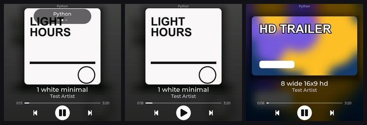

# Milestone 8c — reversed swipes, media-source switching, commands bound to the displayed session, browser artwork

Date: 2026-10-12. Branch: `feature/session-switching` (on top of `feature/art-layout-gestures-volume`). Request (maintainer, after using M8b): swap the horizontal swipe directions, let a vertical swipe browse the media
sessions the PC offers (Spotify, YouTube in Chrome, ... - playing *and* paused), keep the volume keys and the per-app volume, and find out whether the blurry Chrome / YouTube artwork can be improved.
Decision record: [**ADR-005**](../decisions/ADR-005-source-switching-by-vertical-swipe.md).

*Real screenshots from the board with synthetic covers only (no third-party artwork is committed); left to right: the source pill right after a vertical swipe (name + position dots), a paused source (play
icon, its own timeline), and a 16:9 source as a landscape card. The same was verified with the maintainer's real Spotify (paused: play icon, 0:22 / 3:01) and Chrome / YouTube (playing: pause icon, 16:9 card) sessions on the real
display, each selected independently by a vertical swipe; those screenshots are kept locally in the git-ignored `logs/shots/` (`real_chrome_steady.png`, `real_spotify_steady.png`, `real_both_sources.jpg`).*

## 1. Gestures

| Finger | Does | Notes |
|---|---|---|
| **left** | **next track** | was "previous" in M8b |
| **right** | **previous track** | was "next" in M8b |
| **up** | **next media source** | new |
| **down** | **previous media source** | new |
| tap the cover | full-screen toggle | unchanged |
| anything that starts on the progress line | seek only | unchanged: the slider does not bubble its events, so it never starts a swipe |

Classification (`firmware/components/ui/ui.c`, `on_screen_touch`): a swipe needs >= 72 px of travel along its axis, never more than 44 px across the axis *at any moment* (a sticky per-axis flag), the axis motion at least
twice the cross motion, and < 1 s. A diagonal drag strays on both axes and is neither a horizontal nor a vertical swipe. A recognised swipe cancels the touch (`lv_indev_wait_release`) so nothing underneath is clicked,
and a press that travelled > 24 px is never a tap. Horizontal swipes do nothing (gracefully, no feedback) when the app does not offer next / previous; vertical swipes do nothing when the PC offers fewer than two sources.

## 2. The session model (companion)

`GlobalSystemMediaTransportControlsSessionManager.get_sessions()` lists every media session (reading all of them costs < 5 ms, so nothing is cached). `desk_media_companion/sources.py` is the pure model (21 unit tests);
`media.py` applies it:

* **Swipe list ("ring")**: readable sessions that are not `closed` and carry a title or an artist - **playing and paused alike** - plus whatever is on screen. A dead session (the maintainer's PC has `PSExpressCore.exe`, which
  answers "device not ready") and metadata-less sessions are left out. Fixed order (alphabetical by app name, so it does not jump around when playback states change); wraps at both ends:
  `Chrome -> Python (the test session) -> Spotify -> Chrome ...`.
* **Auto mode** (default, and after a restart): follow the best session - the system's current session if it is playing, else any playing one, else the app that played last, else the current one, else the rest.
* **Pinned mode**: a vertical swipe pins the display to the session it lands on. From then on artwork, title, artist, timeline, play/pause, next/previous, seek and volume all belong to *that* session, and another app
  becoming active does **not** take over. When the pinned session disappears the pin is dropped and auto mode takes over (`POST /control/source-auto` and a companion restart also return to auto).
  Consequence worth knowing: a *paused* pinned session keeps the screen even if something else starts playing - a swipe moves on. (A "release the pin after N minutes of silence" rule is a one-constant change if the
  maintainer prefers it.)
* The swipe is relative to **the app the display shows** (`from=`), not to whatever the companion currently thinks, so a session that auto-switched a moment ago cannot make the swipe jump two places.

## 3. Every command names the session on screen

M8b fixed the volume keys with an `app=` parameter; M8c extends it to everything. The display now sends `&app=<app id>` on **play/pause, next, previous, seek, volume up/down** and `from=<app id>` on source switches.
The companion resolves exactly that session; if it no longer exists the request is refused (`{"ok":false,"error":"that media session is gone"}` / `"no media session"`) instead of being redirected to another session.
A source switch answers with the new `/now-playing` snapshot, so the display switches in the same round trip and the next volume press already targets the new app.

## 4. Feedback (nothing permanent)

* a faint 92 px disc with an up / down chevron drifts in the swipe direction over the cover for ~0.4 s (the existing swipe disc, now also for vertical swipes; only drawn when the gesture will do something).
  The vertical disc is only ~0.4 s long and was not caught in a screenshot (the horizontal one, same code, is in the M8b sheet);
* a translucent pill at the top names the source (`Spotify`, `Chrome`, `Edge`, ...) with small dots for its place in the ring, ~1.1 s then a fade. It is the same top-most pill the volume overlay uses, so a volume press right after
  a switch simply replaces it. The status line at the very top already shows the source name permanently.

## 5. Chrome / YouTube artwork

**A. Is there a better source inside Windows / the browser?** No.

* GSMTC's `MediaProperties` has exactly: `title, subtitle, artist, album_artist, album_title, album_track_count, track_number, genres, playback_type, thumbnail`. `thumbnail` is an `IRandomAccessStreamReference` whose
  only method is `open_read_async()`: no size parameter, no variants, no URL. There is nothing about the video (no URL / video id) either.
* **Windows does not downscale.** The silent test session published a 1280x720 PNG and GSMTC returned it byte-for-byte identical (same SHA-256, `logs/art-dump2/3_python_exe.bin` vs the source file).
* **Chromium asks for 150 px itself**: `content/browser/media/system_media_controls/system_media_controls_notifier.cc` has `kMinImageSize = 71` and `kDesiredImageSize = 150` and calls
  `ObserveImages(kArtwork, kMinImageSize, kDesiredImageSize, ...)`. Chrome picks the best match from the page's artwork list for that size and hands Windows that, so the ~150 px thumbnail (150x83 for 16:9) is a Chrome
  decision that no Windows API can change.
* Moreover one real sample (from the maintainer's Chrome session) was a *square album cover inside a 16:9 frame with black pillars*: the companion trims the bars, so it ended up as an **86x83 px** picture enlarged to
  312 px. No algorithm recovers that.

**B. PC-side processing (done).** All resizing is on the PC (Lanczos); the ESP32 only decodes a ready 432x242 / 312x312 baseline JPEG. `companion/tools/art_benchmark.py` shrinks local high-resolution pictures (6 Windows wallpapers
+ a text thumbnail) to 150 px exactly like Chromium delivers them, rebuilds the card with each candidate and scores it against the original (mean of 7 pictures; `edges` = gradient energy relative to the original,
1.0 = as crisp as the original):

| pipeline | PSNR (dB) | edges | halo (over/undershoot) |
|---|---|---|---|
| Lanczos only | 31.69 | 0.56 | 0.01 |
| M8b (Lanczos + global unsharp mask) | 31.78 | 0.61 | 0.04 |
| **shipped: edge-only, halo-limited sharpening** | **31.89** | 0.60 | 0.03 |
| global sharpen + halo limit | 31.50 | 0.68 | 0.07 |
| stronger edge variants | 31.2 - 31.8 | 0.61 - 0.64 | 0.03 - 0.06 |

The honest summary: every candidate lands within ~0.1 of the same sharpness - the information is not in the 150 px image. The shipped pipeline (`artwork.enhance_upscale`) was chosen because it is best on PSNR with no
ringing: the unsharp mask is applied **only at real edges** (Sobel mask; flat areas, skies and JPEG block noise stay untouched), clipped to the local min / max of the un-sharpened picture (no halos), and its strength **ramps with the
enlargement** (0 below 1.5x, full at 2.5x). **Spotify is untouched**: its 233 px cover drawn at 312 px is a 1.34x enlargement, below the ramp, and a unit test pins the JPEG to be byte-identical to plain Lanczos.
On the real display (same Chrome frame, `companion/tools/art_compare.py` and screenshots of the board: `logs/shots/art_before_chrome.png` vs `art_after_chrome.png`) the "after" has visibly crisper edges (eye outlines, highlights, hair)
with no halos or noise in flat areas - a modest but real improvement, still clearly a ~150 px source.

**C. Is a genuinely higher-resolution image possible *without* an extension?** **No.** Everything an outside program can legitimately see is the 150 px stream above. The ways around it, and why none was built:

| Idea | Verdict |
|---|---|
| Search YouTube by title and guess the video | rejected by the maintainer (brittle) and rightly so |
| Read the address bar with UI Automation | only the foreground tab, not necessarily the one playing; breaks with browser UI changes |
| Chrome remote-debugging port | needs a launch flag and opens a debug port to every local program |
| Chrome's `Media History` database | locked while Chrome runs, profile internals, privacy-sensitive |
| **Small Chrome / Edge extension** | the only clean route - see below |

*If the maintainer ever wants it:* a Manifest V3 extension with a content script (main world) reads `navigator.mediaSession.metadata` (title, artist, and the page's own `artwork: [{src, sizes}]` list - the same object Chrome used
to build the 150 px thumbnail) whenever it changes, and posts it to `http://127.0.0.1:8765/browser-media` (loopback only, `X-Desk-Client`). The companion pairs it with the Chrome / Edge GSMTC session by exact
title + artist equality (both come from the same metadata object, so no guessing), downloads the largest suitable image itself (the PC has internet; cached by URL), and serves *that* as the session's artwork, falling back
to the 150 px thumbnail whenever no extension report matches. Costs: one extension per browser on the user's PC (an unpacked extension needs developer mode and a nag banner; a store listing needs a
developer account), the PC fetching images from the internet, and upkeep when sites change. **Recommendation: do not build it now** - Spotify, the main music source, is already sharp and the gain is only for browser tabs.
Whether YouTube / YouTube Music supply large artwork entries should be checked on the maintainer's own machine before anyone commits to it.

## 6. Volume keys follow the source

Unchanged from M8b (PWR upper = up, BOOT lower = down, 5 % steps, per-app Core Audio session volume, never the master volume, "Volume 65%" pill), now with the stricter targeting of section 3.
Verified: after a vertical swipe the very next key press changes the newly displayed app only (see the test list below). Browser limits are as before (Chrome / Edge: whole-browser volume; Firefox: no match).
A paused browser tab may hold no audio session, in which case the pill says "No volume control" until it plays again.

## 7. Verification

* Unit tests: `python -m unittest discover -s companion/tests` - **47 pass** (14 artwork + 4 new upscale tests, 21 session-model tests, 8 HTTP-routing tests).
* `companion/tools/api_check.py` (HTTP only, against a separate companion instance, selection requests only): ring walked forwards and backwards on the maintainer's real sessions, wrap-around, stale `from`, commands aimed at a missing
  session refused, back to auto - all pass.
* `tools/session_test.py` (hardware in the loop: the board's virtual finger / simulated keys, judged from the companion's log and `/sources`; silent fake session `python.exe` next to the maintainer's **real Spotify and Chrome / YouTube**):
  0 failures. It proves: finger left sends NEXT and right sends PREVIOUS to the displayed session (and swipes that start on the title text work); a diagonal swipe sends nothing; a horizontal swipe from the progress line only
  seeks; a vertical swipe from the progress line only seeks and does not switch source; tapping the cover sends no media command; swipe up / down walk the 3-source ring forwards / backwards and wrap around with **no media command and no
  playback-state change anywhere**; a paused session stays selectable and shows its state, play resumes exactly that session; a pinned session is kept while others play; when the pinned session disappears the display falls
  back to auto and the list no longer offers it; the side keys change the displayed app's own volume (fake: 5 -> 0 -> 5 %, real Spotify 55 -> 60 -> 55 %, real Chrome 100 -> 95 -> 100 %) and no other app's volume or the master volume (4 devices) moved.
* `companion/tools/pin_check.py` (a tool for the pin model of that time; since removed) (HTTP only, separate test instance): a real source is pinned while the silent fake session plays (and the maintainer's own Spotify happened to start playing during one run) - the display of that
  instance stayed on the pinned source for the whole 8 s; closing the fake left the pin in place (the pinned session still exists).
* Gesture soak (`tools/soak_gestures.py` + `tools/analyze_soak.py`, 5 minutes of random swipes in all four directions, diagonals, seek-bar swipes, taps and side-key presses / holds; the vertical swipes
  also walked the display over the maintainer's real sessions and back, selection only): 115 scripted actions (112 seen by the board, 43 source switches applied), **0 resets / panics / watchdogs**,
  uptime 61 -> 372 s without a break, internal heap free 152.9 KB first and last (stays 145 - 153 KB), PSRAM free constant at 3.91 MB, LVGL stack free minimum constant at 20.1 KB.
* Real-display screenshots with the maintainer's sessions: Chrome (landscape card, pause icon) -> swipe up -> Spotify (paused: play icon, timeline, "Spotify" pill with 2 dots) -> swipe down -> Chrome, in `logs/shots/`.
* Frozen exe (`companion/build.ps1`, 18.4 MB) starts and serves `/health`, `/sources`, `/now-playing`, `/artwork`.

## 8. Known issues / open points

* **A real finger was not used by me**: gestures were driven through the board's virtual finger, which walks the same LVGL input path as the touch controller; the *physical* feel (distance, speed, the upper PWR key) needs the maintainer.
* A paused pinned session keeps the screen (section 2) - by design, adjustable.
* Chrome / YouTube art stays soft (a ~150 px source). Only a browser extension could change that (section 5C).
* Two sessions that Windows reports under one app id (e.g. two browser profiles) appear as one source.
* Non-Latin glyphs (Japanese / Cyrillic / emoji titles) still render as boxes; no cross-fade between tracks. Both predate this milestone.
