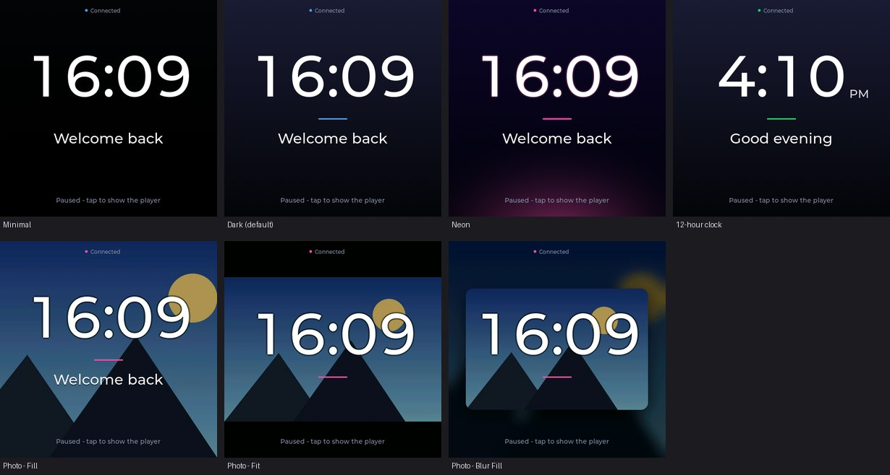

# Milestone 9 — customisable idle screen

Date: 2026-10-12. Branch: `feature/idle-screen` (on top of `feature/auto-follow-spotify-options`). Request (maintainer): replace the generic *"Nothing playing / Play something on your PC"* player placeholder by a proper idle screen that the
end user customises from the Windows companion - no reflashing, no command line - as a **generic product feature**. Anything personal (a name, a photo, a custom theme) stays local data on the user's own PC. Decision record: [**ADR-007**](../decisions/ADR-007-customisable-idle-screen.md).

*Real screenshots from the board (the dev-only screenshot tool), with a synthetic landscape as the Photo background and the text "Welcome back" - nothing personal is committed.*

## 1. Behaviour

| Situation | Display |
|---|---|
| Boot / Wi-Fi / searching for the PC / PC not reachable | the **player screen** with its connection message (as before; the idle screen is never used here) |
| PC connected, something plays (any session) | the **player** - the idle screen is left at the next poll (measured **0.2-0.3 s**), normal auto-source detection picks the session |
| PC connected, nothing plays (no session, or only paused / stopped ones) | the **idle screen**, after the user's delay (default **4 s**, 2-60 s; measured 5.2-5.3 s = delay + poll granularity); **at once** when nothing has played since the display connected |
| A short gap (track change, a video reloading) | nothing: the idle screen only appears after the delay (a 2 s gap was tested - no flash) |
| Tap on the idle screen, a (paused) session exists | the player for 30 s (measured 1.2-1.3 s to appear, held 32 s), so a track paused from the display can be resumed; touching the player keeps it up the same way |
| Tap on the idle screen, no session at all | nothing |

Transitions are a 350 ms LVGL screen fade (`lv_screen_load_anim`, two screens, no layers, no extra buffers).
"Nothing plays" is `any_playing` from the companion: **no usable session is playing anywhere**, not "the displayed one is paused" - a paused session that was swiped to manually while another one plays never blanks the display.

## 2. The settings (Windows companion)

An icon in the notification area -> **Settings...** (double-click, or right-click). No command line, no config file (options `--no-tray`, `--open-settings`, `--data-dir` exist for development).

| Setting | Notes |
|---|---|
| Theme | **Minimal** (near-black), **Dark** (default: soft gradient), **Neon** (violet gradient + accent glow along the bottom + glowing digits), **Photo** (the user's picture; a dim 30 % layer keeps the clock readable) |
| Accent colour | 7 presets or a colour dialog - the line under the clock, the connection dot, the Neon glow |
| Photo background | `Choose Image...` (JPG / PNG) with **Fill**, **Fit**, **Blur Fill**; a live preview *before* Apply; `Remove` |
| Clock | show / hide, 12 / 24 hour (12 h shows AM / PM) - big digital clock in the PC's local time |
| Custom line | one optional line (<= 40 characters, printable ASCII: accents are folded - `Café` -> `Cafe` - other scripts dropped, because the display fonts cannot draw them) |
| Show idle screen after | 2-60 s, default 4 s |
| Reset to defaults | removes the picture too |

Nothing personal is built in: the defaults are Dark, 24 h clock, no text, no picture. The settings, the prepared picture and a copy of the user's original live in `%LOCALAPPDATA%\DeskMediaCompanion\idle\`
(`settings.json`, `background.jpg`, `original.bin`) - outside the repository; `.gitignore` also blocks those names (and `idle-assets/`, `personal/`, `private/`) if they ever land in a checkout.
The tray menu also offers *Start with Windows* (per-user Run key, the existing `autostart` helper) and *Quit*. The exe is built with tkinter and pystray (`companion/build.ps1`).

### Picture processing (all on the PC)

`idle.py`: the file is validated first - <= 25 MB, JPG / PNG only (checked by content, not extension), 16..20 000 px per side, <= 89 megapixels, truncated / corrupt files rejected with a readable message - then EXIF-rotated, transparency matted on black,
fitted: **Fill** = centre-crop cover; **Fit** = the whole picture on dark bars; **Blur Fill** = a blurred, darkened copy fills the screen and the sharp picture (<= 84 % of the screen, rounded corners, soft shadow) sits in front - the same idea as the player's cover.
Result: exactly 480x480, a **baseline JPEG** (the ESP32 decoder is baseline-only) of **<= 200 KB** (quality steps 88..58 until it fits). A failed file changes nothing (the previous setup stays active). Unit-tested (`companion/tests/test_idle.py`, 25 tests).

## 3. Protocol

`/now-playing` gains `any_playing`, `idle_v` (the settings version) and `clock_ms` (PC local time, ms since the epoch); two read-only routes: `GET /idle` (settings JSON + the picture's size / CRC-32) and `GET /idle/image` (the JPEG, `X-Idle-Crc`).
**Settings cannot be changed over HTTP** - only the companion's own window edits them (the API is still unauthenticated until Milestone 13). Details: [`docs/architecture.md`](../architecture.md).

## 4. Display

`firmware/components/idle_screen/`: its own LVGL screen; the player screen is untouched. `main.c` decides which screen shows (the rules above, from `any_playing`).
* **Cache and sync**: settings in NVS (`idle` namespace), the picture in the new **`idle_img` 1 MB partition** (raw: a 4 KB header sector + the JPEG; the header is written last, so an interrupted write means "no picture"; CRC re-checked on every load).
  `pc_media` compares `idle_v` with the stored version on every poll; only a difference triggers `GET /idle` and - only if the CRC changed - `GET /idle/image` (back-off 5 s / 15 s / 60 s on failure). Nothing is resent after a reboot of either side.
* **Partition table**: `idle_img` was carved out of the unused 7 MB `storage` partition (now 6 MB; nothing referenced it). `nvs` and `factory` keep their offsets, so the NVS data survives a flash. Old and new layout are in `firmware/NOTICE.md`.
* **Drawing**: one pre-baked RGB565 image in PSRAM (a dithered gradient generated on the display for the built-in themes, or the photo decoded once and dithered) + a handful of labels; nothing animates. The 1 s clock tick runs only while the screen is visible and rewrites the label only when the minute changes.
  The big digits are a generated font (`tools/gen_clock_font.py`: Montserrat Medium 128 px, digits and `:`, tabular, 35 KB) because LVGL's built-in Montserrat ends at 48 px.
* **Fallbacks**: a missing, corrupt, undecodable or wrongly-sized picture -> the built-in Dark theme (an undecodable one is not downloaded again for the same CRC); a damaged stored picture is re-requested.
* New buffers are built off-screen and swapped in under the LVGL lock; the previous one is freed afterwards (never rewritten while it is on screen).

## 5. Verification

Unit tests: **98 pass** (70 before + 25 in `test_idle.py` + 3 route tests in `test_server.py`).

Board-in-the-loop, `tools/idle_test.py` - an in-process companion that sees **only two silent fake sessions** (so the maintainer's real apps and display are never touched), the board's serial log and real screenshots of its LVGL screen. Results on the board (dev build):

| # | Maintainer's check | Result |
|---|---|---|
| 1 | nothing playing -> idle appears | idle screen at boot with the PC connected (4.5 s after power-up); screenshot: Dark theme, large clock, "Nothing playing" |
| 2 | a session starts -> idle changes to it at once | player after **0.2-0.3 s**, showing that session |
| 3 | A pauses, B plays -> B | B shown, **no detour through idle** (screen events checked) |
| 4 | everything pauses -> idle after the short delay | idle after **5.2-5.3 s** (delay 4 s); a 2 s gap never flashes it |
| 5 | custom image survives a board reboot | reboot: `stored settings loaded: version 13, theme 3, picture` at 2.8 s, **no** `/idle` or `/idle/image` request afterwards, the picture is on screen |
| 6 | companion restart keeps the settings | a restarted companion (new process-like server, open connections dropped) serves the same version / settings / picture; the board did not resync and did not reset |
| 7 | Fill / Fit / Blur Fill | pixel checks on screenshots with a red \| blue 2:1 picture: Fill covers the whole screen; Fit leaves dark bars above / below and reaches both side edges; Blur Fill: blurred tinted surround, sharp brighter picture in front |
| 8 | clock updates correctly | the digits equal the same time rendered with the same typeface (overlap 0.95+), 24 h and 12 h (+ AM / PM); a screenshot before and one after a minute change show the new minute; clock hidden -> no digits |
| 9 | broken / missing picture falls back | Photo theme without a picture -> Dark; a corrupt JPEG with a valid CRC -> logged `cannot be decoded`, Dark theme shown, no reset; a good picture afterwards recovers; the PC rejects junk files and keeps the old picture |
| 10 | repeated idle <-> playback, no crash / growth | **30 cycles over 315 s** (3 s playing, 7.5 s paused, Neon theme + text): 30 player / 30 idle transitions, **0 resets**, internal heap free 142 583 -> 142 595 B, low-water mark 92 452 B constant, PSRAM free 2 972 872 B constant, LVGL stack min 20 156 B constant, poll-task stack min 9 292 B of 12 288 |

Also checked: the 4 themes and accents, the custom line / no-clock layouts, tap-to-peek (with and without a session), and the packaged exe (`companion/build.ps1`, now 23.6 MB with tkinter + pystray): it starts, serves `/idle` and the new `/now-playing` fields, opens the settings window, logs no errors.

## 6. Not verified / for the maintainer

* **The look on the real panel** - the screenshots are of the LVGL buffer; colours, dithering and fade smoothness on the glass are the maintainer's to judge.
* **A brief screen flicker while a *new picture* is being written to flash** (about 1-2 s, in 4 KB steps with short pauses) is possible: the RGB panel reads PSRAM while the flash is busy and the project does not enable the IRAM-safe RGB ISR. Only pressing Apply with a *new picture* does it; changing text, theme, accent or clock writes only NVS. If it is visible it can be hidden by writing only while the idle screen is up.
* The tray icon in the real exe (the icon area is not capturable from here); the window itself was checked.
* The maintainer's own picture / real Spotify and Chrome through this feature: the tests used the silent fake sessions on purpose.

## 7. Files

Generic (committed): `companion/desk_media_companion/{idle.py,ui.py}` (+ `__main__.py`, `media.py`, `server.py`), `companion/tests/test_idle.py`, `firmware/components/idle_screen/` (+ `pc_media`, `main`, `health.c`), `firmware/partitions.csv`, `tools/gen_clock_font.py`, `tools/idle_test.py`, docs.
Never committed: anything in `%LOCALAPPDATA%\DeskMediaCompanion\idle\` - the user's settings, picture and original.
