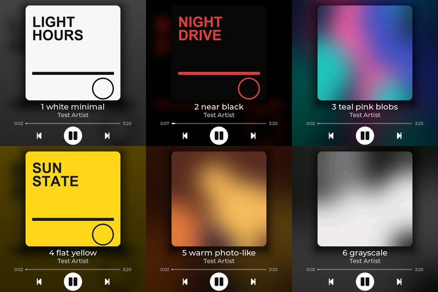

# Milestone 8 — main player visual redesign

Date: 2026-10-12. Branch: `feature/player-redesign` (merged to `main`). Request: the MVP screen "still looks too prototype-like" - bigger cover as the
focal point, no framed card, background derived from the cover, no empty borders, clean readable foreground, finished-product look.

*Real screenshots taken from the board (not mock-ups): white, near-black, colourful, flat yellow, warm photo-like and grayscale test covers.
These are synthetic covers made by `companion/tools/make_test_covers.py`; no third-party artwork is committed.*

## What changed

| Before (MVP) | Now |
|---|---|
| 260 px cover inside a rounded card with a grey/empty margin | **312 px cover, no frame**; the box only rounds the corners (14 px) |
| flat dark background | **whole-screen background derived from the cover**: blurred, saturated, darkened, with a soft shadow behind the cover |
| 16:9 thumbnails letterboxed with dead black bars | wide/tall art keeps all its content, the rest of the square is a **blurred copy of the image** (companion side) - no empty borders |
| prev/next in grey circles, thick bar, times under the bar | big **white play/pause**, plain prev/next icons (dimmed when unsupported), **thin progress line as wide as the cover with the times at its ends**, knob only while dragging |
| LVGL gradient background (visible banding) | baked, ordered-dithered gradient when there is no artwork; cover decoded to RGB888 and dithered down to RGB565, so smooth gradients do not band |

Layout (480x480): status line y 2, cover y 18..330 (x 84..396), title y 336 (26 pt), artist y 367 (20 pt), progress line at y 406, controls centred at y 446
(play 60 px, prev/next 64 px touch areas). Title and artist scroll when too long; the status line shows the source app.

## How it works (so it stays fast and stable)

* The background is **one pre-baked RGB565 480x480 image per track**, generated on the board right after the cover is decoded (~60-90 ms, in the network task, PSRAM scratch):
  cover -> 40x40 colour grid -> +40 % saturation -> two 3x3 box blurs -> smooth-step interpolation to full size -> vertical darkening (0.52 -> 0.30, extra
  darkening for bright covers) -> soft shadow behind the cover rectangle -> 4x4 Bayer dither. LVGL only blits it: no runtime blur, no full-screen overlay,
  nothing that re-renders on every progress tick.
* Double-buffered in PSRAM (2 x 460 KB backgrounds, 2 x 200 KB covers, 300 KB decode scratch), allocated once - no heap churn. The cover is requested from the
  companion at exactly its on-screen size (`/artwork?size=312`), so no scaling.
* The UI/network split is unchanged: `pc_media` -> callbacks -> thread-safe `ui_*`; the control path is untouched.

## Verification

* **Real-display screenshots** with the new `tools/screenshot.py` (dev build `-DAPP_DEV_TOOLS=1` + companion `--dev-tools`): the board renders its LVGL screen to RAM and sends it
  over USB serial (CRC-checked), and the PNG was inspected for seven different covers (bright, dark, colourful, flat, grayscale, 16:9 YouTube thumbnail, a very wide
  anime frame), for the placeholder state and for the full-screen mode (tap the cover; tap again returns). Findings from the first round were fixed:
  muddy grey background on bright covers (-> adaptive darkening), banding in the no-art gradient (-> baked dithered gradient), dead bars around wide art
  (-> blurred fill), contour bands in smooth covers (-> RGB888 decode + dither), status line showing the previous app (-> event-order bug).
* **Controls still work with the new UI**: the owner pressed the on-screen buttons while the redesign was running; the companion log shows
  `control playpause` and `control next` from the board (192.168.1.152) executed on the test session, and the health line shows no resets.
  (Real taps are the only thing the screenshot tool cannot replace: it can press the cover, and play/next/prev only on the silent test session.)
* Artwork loading, title/artist updates, progress, play/pause, previous/next: unchanged code paths, re-exercised after the redesign (see log excerpts in the commit).

## Known issues / not yet done

* Fonts: Montserrat has no CJK / Cyrillic / emoji glyphs (many YouTube titles) - fallback font still to do.
* Full-screen mode stretches the 312 px cover to 456 px (soft) - Milestone 10.
* No fade between tracks (the background swaps instantly).
* The idle / "nothing playing" screen still reuses this layout with a message - Milestone 9 replaces it with the Cyberpunk idle screen.
* The owner's own visual judgement of the new look is still to be collected.
