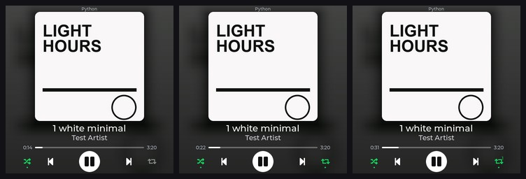

# Milestone 8d — auto-follow restored after manual swipes, Spotify-only Shuffle and Repeat

Date: 2026-10-12. Branch: `feature/auto-follow-spotify-options` (on top of `feature/session-switching`). Request (owner, after using M8c): a vertical swipe must be a *temporary* way to browse sources, not a permanent
pin - auto-follow has to come back - and Spotify should get Shuffle and Repeat buttons (Spotify only, nothing for Chrome / YouTube). Decision record: **ADR-006** in `docs/DECISIONS.md`.



*Real screenshots from the board, synthetic covers only (no third-party artwork is committed): the dev-only flag `--treat-as-spotify` makes the companion regard the silent fake test session as Spotify. Left to right: shuffle on + repeat
off, repeat the playlist (green + dot), repeat the track (green + a small "1"). The checks with the owner's real Spotify (buttons shown, shuffle on) and Chrome / YouTube (no buttons) were done on the real display too; those
screenshots are kept locally in the git-ignored `logs/shots/m8d/` (`real_both.jpg`).*

## 1. What was wrong with M8c

M8c turned a vertical swipe into a *pin*: the chosen session stayed on screen for as long as it existed, so after browsing to a paused YouTube tab the display stopped following what was playing. That is useful for inspecting a
session and wrong as the normal behaviour.

## 2. The selection model: `AUTO` and `MANUAL_TEMP`

`companion/desk_media_companion/sources.py` (`Selector`, pure logic, time passed in, no WinRT): two explicit states.

| State | Shows | Ends when |
|---|---|---|
| **AUTO** (default, long-term) | the playing session that **started playing most recently** (ties: the system's current session, then Windows' order); nothing playing: the app that played last, then the system's current session, then the rest | - |
| **MANUAL_TEMP** (entered by a vertical swipe) | the session the user swiped to, with all its artwork / title / timeline / controls / volume | (a) **another** session starts playing (pause -> play transition, or a new playing session appears) - immediately; (b) the selected session disappears - immediately; (c) the selected session is **not playing**, another one is, and the user has not touched the selected session for **20 s** |

* The selected session *itself* starting to play (the user pressed play on it - case C) is not a reason to leave it, and a swipe that lands on what AUTO would show anyway is simply AUTO.
* "Started playing" is judged on settled states only: the brief `changing` / `opened` states Spotify goes through when it skips to the next track are not transitions (unit-tested), so background track changes do not end a manual selection.
* "Interaction" that restarts the 20 s timer: any control, seek, shuffle / repeat or volume key aimed at the selected session, and another swipe. Merely looking does not count. The timer exists only for the one case no event can ever
  announce ("Spotify just keeps playing while I look at the paused video"); when nothing plays at all the selection is simply kept, because there is nothing better to show.
* A **background watcher** (`MediaMonitor._watch`, every 0.4 s, a few ms per look at all sessions) feeds the model, so transitions are noticed within ~0.5 s even when the display is not polling; `_select` also observes on every poll.
* `mode` (`"auto"` / `"manual"`) replaces `pinned` in `/now-playing`, `/sources` and the swipe answer. `POST /control/source-auto` still forces AUTO (support aid).
* **Commands** are unchanged in principle: the display names the session it shows in every request and the companion refuses it if that session is gone. When AUTO moves the display, the very next poll (<= 1 s) moves the screen and
  from then on play/pause, next / previous, seek, shuffle / repeat and the volume keys follow it (verified, section 5).

## 3. Spotify shuffle and repeat - the investigation first

*Does Windows expose them for Spotify?* **Yes, completely** (`companion/tools/dump_transport.py`, read-only, on the owner's PC):

```
Spotify.exe  is_shuffle_active=True  auto_repeat_mode=NONE   controls: shuffle_enabled=Y repeat_enabled=Y next=Y previous=Y seek=Y ...
chrome.exe   is_shuffle_active=None  auto_repeat_mode=None   controls: shuffle_enabled=-  repeat_enabled=-  ...
```

and Spotify **accepts** the changes (`companion/tools/probe_transport.py`, which restores everything): `try_change_shuffle_active_async` and `try_change_auto_repeat_mode_async` return `True`, the state reads back ~105 ms later, and all three
repeat modes work (`NONE`, `LIST` = repeat the playlist / album, `TRACK` = repeat the song) - exactly Spotify's own three states. So: **Windows-native, no Spotify account, no OAuth, no Web API.** Chrome / YouTube / Edge report
nothing, hence no buttons for them.

* "Spotify" is decided by the session's **app identity** only (`sources.is_spotify`: `Spotify.exe`, or the Store package `SpotifyAB.SpotifyMusic_...`), never by track metadata (unit-tested, including look-alike names).
* `/now-playing` adds `spotify`, `shuffle`, `repeat` (0 off, 1 playlist, 2 track), `can_shuffle`, `can_repeat` (all false / 0 for every other app).
* `POST /control/shuffle` toggles, `POST /control/repeat` cycles off -> playlist -> track -> off (explicit forms `/shuffle-on|off`, `/repeat-off|list|track` exist for tests). The answer waits (<= 0.6 s) until Windows reports the change and carries the fresh
  `/now-playing`, so the display shows the real state at once. Every other app gets `ok:false, "error":"shuffle / repeat are only offered for Spotify"`.

## 4. The two buttons

Layout (`firmware/components/ui/ui.c`): the transport row is unchanged (previous / play / next at the same positions and sizes); **shuffle sits left of previous and repeat right of next**, 178 px from the centre, 20 pt icons against 24 pt for previous / next
and 32 pt for play, so play stays the focus and nothing looks crowded. Only while the displayed session is Spotify:

| State | Look |
|---|---|
| off | white icon at 50 % - subtle |
| on | Spotify green + a 4 px dot below (the state is not carried by colour alone) |
| repeat track | green + a small "1" on the loop icon |
| Spotify refuses the change right now | the button is dimmed |

Taps toggle optimistically and are corrected by the PC's answer; both buttons bubble their touch events, so a swipe that starts on them still swipes. They are hidden in full-screen mode, in the idle message and for every other app.
The album art, the blurred background, the cover size and the title / artist / progress positions did not change.

## 5. Verification

* **Unit tests** (`python -m unittest discover -s companion/tests`): **70 pass** - 43 for the selection model (`Selector` on scripted timelines for cases A-E, the 20 s idle rule and its timer restart, track-change blips that must not count,
  recency ordering, Spotify identity incl. look-alike names), 18 artwork, 9 HTTP routing (incl. the shuffle / repeat routes and `app=` targeting).
* **Isolated end-to-end** (`tools/auto_follow_test.py`): a companion that sees only two silent fake sessions through the real Windows media-session API - A = `python.exe` (treated as Spotify by the dev flag), B = `deskfakeb.exe` (a renamed copy
  of the interpreter, so it is a second app) - **48 checks, 0 failures**: auto-follow before any swipe (A -> B -> A by start order, last-played kept when everything is paused); **case A** (browse to paused B, A pauses -> B stays, A starts -> back to A in auto;
  and "A just keeps playing" -> back after 20.2 s; touching B restarts the timer: still on B 28 s after the swipe, back 20 s after the seek); **case B**; **case C** (play pressed on the selected paused session -> it plays, A plays too, the display stays on it, also past
  the idle time); **case D** (selected session closes -> auto at once, no longer offered, a swipe with one source does nothing, a command aimed at the closed session is refused); **case E** (swipes cycle between paused sessions and the selection is
  kept 22 s with nothing playing); shuffle toggles / repeat cycles 1, 2, 0, explicit modes, state survives a track change, every shuffle / repeat request for the non-Spotify session is refused.
* **The owner's real sessions** (`tools/real_cases.py`: real Spotify desktop + real YouTube / Netflix in Chrome, both apps muted through their own Windows volume for the test, refuses to run if either is playing, restores play states and volumes):
  **17 checks, 0 failures** - auto-follow before any swipe, Spotify identified with shuffle / repeat while Chrome shows none, **case B**, **case A**, **case C**, **case E**; the end state was both paused and both volumes 100, exactly as found.
* **Board in the loop** (`tools/session_test.py`, the board's virtual finger / simulated keys, judged from the companion's log; silent fake `python.exe` next to the owner's real sessions): **56 checks pass**. New or changed since M8c: finger left / right
  still send next / previous, vertical swipes still walk the ring and change no playback; when the displayed fake pauses while another app plays, auto-follow moves to the playing one; a paused session is still reachable by swipe and shows its state; play on it
  keeps it; a manual selection ends when another session starts playing and **the controls follow the auto-switched display** (play/pause went to the new session); a selected session that closes -> auto; the side keys follow the displayed app; **the shuffle button
  on the fake Spotify toggles shuffle, three taps on repeat cycle off -> playlist -> track -> off; no shuffle / repeat for Chrome (tapping where the buttons would be sends nothing); on the owner's real Spotify a tap changes the real shuffle and three repeat taps walk
  through all three modes, both restored to what they were (shuffle on, repeat off).** The one failing line of that run, "the real sessions' playback states are as before", is the owner pausing Spotify by hand during the run: the companion log shows the
  only commands that reached the real apps were those shuffle / repeat taps and one volume down + up pair each. (An earlier run also failed three lines because of test bugs - a leftover 0 % volume of the fake and a stale assumption from the old pin model - fixed in the test.)
* **Soak** (`tools/soak_gestures.py` + `tools/analyze_soak.py`, 5 minutes of random swipes in all four directions, diagonals, seek-bar swipes, taps, the new shuffle / repeat taps and side-key presses / holds against the fake Spotify; the vertical swipes also walked the display over the
  real sessions and back, selection only): 117 scripted actions (116 seen by the board, 40 source switches applied, 9 shuffle / repeat commands), **0 resets / panics / watchdogs**, uptime 281 -> 613 s unbroken, internal heap free 140 - 151 KB (low-water mark steady at 91.2 KB),
  PSRAM free 3.89 - 3.91 MB, LVGL stack free minimum constant at 20.1 KB.
* **Real display**: the owner's Spotify (paused, shuffle on): previous / play / next unchanged, a green shuffle with a dot at the left and a subtle repeat at the right; the owner's Chrome / YouTube: nothing added (`logs/shots/m8d/real_both.jpg`).
* Frozen exe (`companion/build.ps1`, 18.4 MB) starts and serves `/health`, `/sources`, `/now-playing` (with `spotify` / `shuffle` / `repeat` for the real Spotify) and refuses shuffle for Chrome.
* The product firmware (`-DAPP_DEV_TOOLS=0`) boots, finds the PC and shows the media (see the commit message / final report).

## 6. Known issues / open points

* Physical finger input and the physical PWR key still need the owner (the virtual finger walks the same LVGL input path as the touch controller).
* While a *paused* session is selected and another one plays, the display returns to the playing one after 20 s of not touching it (the one timeout in the model; `MANUAL_IDLE_RETURN_S`).
* Shuffle / repeat appear for the Spotify desktop app only; the Spotify web player in a browser is just a browser tab to Windows and gets no buttons.
* Accented Latin letters (e.g. the "e with diaeresis" in a real Spotify title shown during testing), Cyrillic, CJK and emoji still render as boxes - the UI fonts are ASCII-only Montserrat. A follow-up task has been spawned; it is unrelated to this change.
