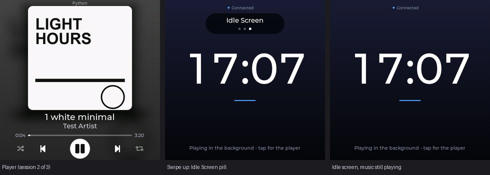

# Milestone 9b — the idle screen as an item of the vertical source ring

Date: 2026-10-12. Branch: `feature/idle-source` (on top of `feature/idle-screen`). Request (owner, after using M9): include the idle screen in the same vertical swipe list as the media sessions -
`Spotify <-> Chrome / YouTube <-> Idle Screen` - as a *display choice*, with auto-follow kept intact. Decision record: **ADR-008** in `docs/DECISIONS.md`.

*Real screenshots from the board with the silent fake test sessions (nothing from the owner's real apps). Left: the player (session 2 of 3). Middle: 0.25 s after swiping up - the idle screen with the subtle "Idle Screen" pill (three dots, the third is the idle item). Right: the idle screen while the session keeps playing in the background.*

## 1. Behaviour

| Situation | Result |
|---|---|
| The ring | sessions (playing **and** paused, alphabetical) + one synthetic **Idle Screen** item, always last; wraps at both ends. Offered whenever the companion is connected. With no session it is the only item (a swipe does nothing); with one session plus Idle it is two sources |
| Swipe up / down | next / previous item, on the player **and on the idle screen** (same thresholds and safeguards). The pill shows "Idle Screen" + position dots, over the screen that is becoming visible |
| Swipe onto Idle while Spotify plays | the configured idle screen at once (0.3-0.7 s measured); **Spotify keeps playing** (checked: no command reaches any app) |
| Auto-follow | **any session that starts playing** - or a paused one resuming - ends the choice and the display follows it (0.5-0.8 s measured). Idle never pins. It also ends by a **tap** on the selected idle screen (back to automatic) |
| Staying on Idle | as long as nothing new starts: **no timeout** (the 20 s return of ADR-006 does not apply: Idle is chosen while something plays) - verified for 24 s with both sessions playing |
| Controls while Idle is shown | transport controls are not there (they belong to the player screen); **horizontal swipes do nothing**; the **side volume keys do nothing**, and the companion refuses every `/control/*` and volume request aimed at `idle` - so no unrelated app's volume can change |
| Swipe from the *automatic* idle screen (nothing plays) | relative to what the user sees (`from=idle`): up -> the first session, down -> the last; the session's (paused) player stays up for 30 s (a swipe counts as using it), it does not bounce back |
| Tap on the automatic idle screen | unchanged from M9: peek at a paused session's player for 30 s |

## 2. How it is built

* `sources.py`: `IDLE_ID = "idle"`, `ring/step/position(..., idle=True)`, `Selector.idle_selected` - a MANUAL_TEMP selection with `manual == "idle"`; `observe()` ends it on any start of playing and has no disappearance / 20 s rule for it; `order()` keeps returning what AUTO would show, so the snapshot underneath is current. 13 new model tests (`test_sources.py::IdleItem`).
* `media.py`: the snapshot gains `idle_selected` (and `mode: "manual"`), `sources` / `source_index` count the item; `switch_source` understands `from=idle`; `/sources` lists a `synthetic` row; `control()` / `volume()` refuse `app=idle` before touching any session (unit-tested without Windows).
* Display: `pc_media` carries `idle_selected`, sends `from=idle` when the idle screen is up (command arg), and a new `SOURCE_AUTO` command; `main.c` makes a selected idle screen win over the delay / peek logic, ignores the side keys while the idle screen is visible and treats a tap on a selected idle screen as "back to automatic" (a 1.5 s guard ignores a stale report);
  `ui.c` attaches the vertical-swipe handler to a second screen (`ui_attach_vertical_swipes`), moves the source pill to the screen that is becoming visible (a little lower on the idle screen so it clears its "Connected" caption) and exposes `ui_touch_moved()` so a sloppy diagonal is not taken for a tap.

## 3. Verification

Unit tests: **113 pass** (98 + 13 model tests + 2 route / guard tests).

* `tools/idle_source_test.py` - isolated, API level (own companion, two silent fake sessions, the real Windows media API): the ring `[B, A, Idle Screen]`, swipe from A onto Idle (flagged, 3 of 3), A not paused, six kinds of media / volume request refused for `idle`,
  still on Idle after 23 s, swipes down / up from Idle (wraps both ways), a starting session and a resuming one both end it, `source-auto` clears it - **0 failures**.
* `tools/auto_follow_test.py` (the earlier isolated selection test, 48 checks: auto-follow, manual selections, Spotify buttons) was kept in step (it steps over the idle item with a `hop()` helper and expects "one session + Idle Screen" to be two sources) - **48 / 48**.
* `tools/session_test.py` (the board's gesture / ring / play-pause / volume test, with the owner's real Chrome next to the fake session): the ring is now `[Chrome, Python, Idle Screen]` and it walks it forwards and backwards with wrap-around; horizontal swipes, title swipes, diagonal, progress-bar swipes, taps, play / pause, paused sources, auto-follow - **31 / 31 passed**, then the run stopped itself
  at its safety guard (the real Chrome had become the displayed session, and the test never presses media controls on real sessions). Side-button volume on a normal session is checked in the carousel phase below.
* `tools/idle_test.py --only carousel,...` - on the board, with real virtual-finger swipes, key presses and screenshots: **see the table below**.

| # | Owner's check | Result on the board (real virtual-finger swipes, key presses, screenshots) |
|---|---|---|
| 1 | Spotify + Chrome + Idle all appear in vertical cycling | `/sources` and the swipes walk `[YouTube-like, Spotify-like, Idle Screen]`; the snapshot counts 3 sources (the Spotify-like session is 2 of 3) |
| 2 | Idle can be reached while Spotify plays | a swipe up on the player shows the idle screen after **0.7 s**, with the "Idle Screen" pill (3 dots) drawn below the caption; the companion reports `idle_selected: true` |
| 3 | Selecting Idle does not pause Spotify | Spotify still `playing` afterwards and **0** control commands reached the companion (counted in-process) |
| 4 | Starting another session makes auto-follow leave Idle | the other session starting: player after **0.7 s**, automatic mode, Spotify still playing. Staying on Idle for 24 s with both sessions playing: no timeout. A paused session *resuming* also ends it (API test) |
| 5 | Swipe up / down from Idle reaches the neighbours | down from Idle -> Spotify (2 of 3) with the player back; up from Idle wraps to the first item (a paused session's player, Spotify keeps playing, no idle); down from the first item wraps onto Idle. From the *automatic* idle screen (nothing playing) a swipe up shows the first session's player and it stays up |
| 6 | Horizontal gestures on Idle do nothing | left, right, left: no next / previous sent, the track did not change, the display stayed on Idle |
| 7 | Volume buttons on Idle do not alter unrelated apps | 4 key presses: **0** volume requests reached the companion, no app's volume moved; the companion additionally refuses every request with `app=idle`. On the player the keys still work: the displayed session's own volume 50 -> 45 -> 50 |
| 8 | No crashes / resets | **0 resets** in every phase. Ring soak: 40 x (swipe up onto Idle, swipe down back) - 40 / 40 registered and logged, steady internal heap 142 487 -> 142 511 B, low-water mark 92 236 -> 86 060 B (momentary dips when allocations coincide; floor checked >= 60 KB), PSRAM 3 433 548 -> 3 433 684 B, LVGL stack minimum 20 148 B constant. Playback soak (20 play / pause cycles with the Neon theme): 20 / 20, heap 142 527 -> 142 535 B, poll-task stack minimum 8 884 B of 12 288 |
| - | Also | a tap on a *selected* idle screen returns to the player (back to automatic) without bouncing back; tap-to-peek on the automatic idle screen still works (0.8 s, held 32 s) and does nothing without a session; the clock, themes and picture of M9 are unchanged |

Note on the serial log: the USB console very occasionally drops a log line (about 2 in 600 observed); the soak therefore verifies every cycle through the companion's own state (`idle_selected` after each swipe) and tolerates a missing log line.

## 4. Not verified / for the owner

* The look and feel on the real panel (the pill, the fade, the swipe on the idle screen) and the real finger: all the swipes here are the board's virtual finger through the real LVGL input path.
* Real Spotify / Chrome: the tests use the silent fake sessions (same Windows API); with the owner's apps `tools/real_cases.py` was kept in step (it steps over the idle item) but not re-run while the owner was using them.
* Choice made where the request left room: while the idle screen is shown the side volume keys do **nothing** (no "most recently displayed session" fallback), documented in ADR-008.

## 5. Files

Generic (committed): `companion/desk_media_companion/{sources.py,media.py,server.py}`, `companion/tests/{test_sources.py,test_server.py}`, `firmware/components/{pc_media,ui}`, `firmware/main/main.c`, `tools/{idle_source_test.py,idle_test.py,session_test.py,auto_follow_test.py,real_cases.py}`, docs.
