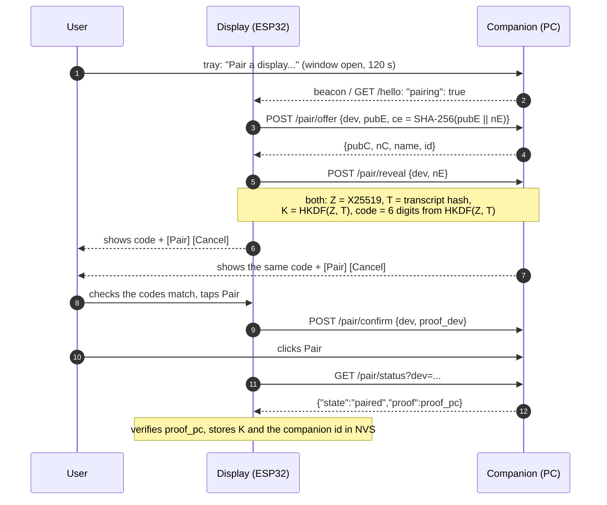

# Protocol: DeskMedia Companion <-> display

This file defines the **API** the Windows companion and the ESP32 display speak (routes, JSON, pairing, authentication; *API version 2*).
The API has two interchangeable **transports**:

| Transport | Status | How the API travels |
|---|---|---|
| **USB cable** (DMLINK v1) | default, the product's way of working | each request is one framed message (the method, the target, a line break, an optional body) over the board's serial port, the answer a framed response with the same status codes and JSON bodies: [usb-protocol.md](usb-protocol.md). Presence, discovery and the session handshake are in that document; sections 3 (pairing) and 4 onward of this file apply unchanged |
| **LAN** (optional, off by default) | developer / fallback | the two channels below |

| LAN channel | Port | Purpose |
|---|---|---|
| UDP broadcast ("beacon") | 8766 | the companion announces itself, so the display needs no IP configuration |
| HTTP/1.1, plain text | 8765 | now-playing state, artwork, idle-screen settings and the control commands |

On USB the per-request MAC of section 2 is replaced by a session: the cable is point-to-point and carries no other client, so the display
and the companion prove possession of the pairing key once per connection ([usb-protocol.md](usb-protocol.md) section 7) and the routes that
need pairing are then served on that connection. The LAN-only protections of section 2 (private-client check, Host header, `X-Desk-Client`) have no meaning on a cable and are not applied there.

Everything below describes **protocol version 2** (the first version with pairing and request authentication). The reasoning and
the threat model are in [security.md](security.md); this file is the byte-level contract that the companion
(`companion/desk_media_companion/`) and the firmware (`firmware/components/pc_media/`) both implement.

## 1. Beacon

Broadcast every 2 s from every real LAN interface (VPN / virtual adapters are skipped):

```
DESKMEDIA2 {"v":2,"port":8765,"name":"<PC name>","id":"<companion id, 16 hex>","paired":true,"pairing":false}
```

* `id` identifies one companion installation (8 random bytes, created at the first start, never secret).
* `paired`: a display is currently paired. `pairing`: the user has opened the pairing window on the PC (section 3).
* The display uses the packet's source address as the PC's IP. The beacon is **not trusted for anything but locating a candidate**:
  every later message is authenticated (section 2).

## 2. Authenticated requests

All routes are served only to private / loopback / link-local clients, require an IP-literal `Host` header (blocks DNS rebinding)
and, for `POST`, the header `X-Desk-Client` (a browser page cannot add it cross-origin without a CORS pre-flight, which is never approved).

On top of that, **every route except** `GET /hello`, `GET /health` and the pairing routes (section 3) needs a valid signature.
Requests from the PC itself (loopback) are exempt: any local process already has the same access to the Windows media APIs.

After pairing both sides share a 256-bit key `K`. `K` never crosses the network again; requests are signed with it.

**Nonces.** Every response (success or error) carries `X-DM-Next: <nonce>`: 16 random bytes as 32 lowercase hex characters, valid
once and for 60 s (the companion keeps at most 32 outstanding ones). A client without a nonce asks `GET /hello` for one.

**Request.** The client sends the last nonce and a MAC over it, the method and the request target (path plus query exactly as it
appears on the request line):

```
X-DM-Nonce: <nonce>
X-DM-Auth:  hex( HMAC-SHA256( K, "DMREQ1\n" + nonce + "\n" + METHOD + "\n" + target ) )
```

**Response.** For a request that passed, the companion proves it knows `K` and binds the answer to the request, so a rogue host
cannot feed the display fake now-playing data or a crafted JPEG:

```
X-DM-Proof: hex( HMAC-SHA256( K, "DMRESP1\n" + nonce + "\n" + status + "\n" + hex(SHA-256(body)) ) )
```

The display verifies `X-DM-Proof` on every response except `401` / `429` and discards answers that fail.

**Failures.** A missing, wrong, expired or replayed signature gives `401 {"ok":false,"error":"auth"}` (plus a fresh `X-DM-Next`, so
the client can retry at once); with no display paired: `401 {"ok":false,"error":"unpaired"}`. More than 10 failures from one address
within a minute are answered with `429` for the next minute (only signature failures count - not `unpaired`; `/hello`, `/health` and `/pair/*`
keep answering a blocked address). Each client address may hold at most 8 of the 32 outstanding nonces, so a host that merely polls `/health` cannot
push the display's nonce out. Requests with a `Transfer-Encoding` header (chunked bodies) or an invalid `Content-Length` are refused with `400`, bodies
above 4 KB with `413`, and the connection is closed; such framing errors are answered before the signature is checked and carry no `X-DM-Next`.
`X-DM-Next` is also absent from answers the guard itself gives (non-LAN client, bad `Host`, missing `X-Desk-Client`) and from `405` / `501`.
Nothing secret (key, nonce, MAC) is ever logged.

## 3. Pairing

A display pairs with exactly one companion, and the companion with exactly one display. Pairing needs **a human on both ends**:
the user opens the pairing window on the PC (tray menu "Pair a display...", open for 120 s), the display shows a 6-digit code and
**Pair** / **Cancel** buttons, the PC shows the same code, and the user confirms on both after checking that they match.

It is an authenticated key agreement in the style of Bluetooth "numeric comparison": ephemeral X25519 (RFC 7748) with a commitment
by the display, so a man in the middle on the LAN cannot make the two codes agree except with probability 10^-6 per attempt, and
a passive listener learns nothing.



Definitions (`||` = concatenation, all values raw bytes unless noted, hex = lowercase):

* `cid` 8 bytes (the companion id), `dev` 8 random bytes chosen by the display per attempt, `nE` 16 random bytes (display),
  `nC` 16 random bytes (companion), `pubE` / `pubC` the 32-byte X25519 public keys (fresh per attempt).
* `ce = SHA-256(pubE || nE)` (the display commits to its nonce before it sees `nC`).
* `Z = X25519(own private, peer public)`; an all-zero `Z` aborts the pairing.
* `T = SHA-256("DMPAIR1" || cid || dev || pubE || pubC || nE || nC)`.
* `PRK = HKDF-Extract(salt = T, ikm = Z)` (HMAC-SHA256, RFC 5869); `K = HKDF-Expand(PRK, "DMKEY1", 32)`;
  `code = (big-endian uint32 of HKDF-Expand(PRK, "DMSAS1", 4)) mod 10^6`, shown as 6 digits with leading zeros.
* `proof_dev = HMAC-SHA256(K, "DMPAIR-DEV\n" + hex(T))`, `proof_pc = HMAC-SHA256(K, "DMPAIR-PC\n" + hex(T))`.

Routes (unauthenticated by nature; all JSON; bodies are limited to 1 KB):

| Route | Meaning |
|---|---|
| `GET /hello` | `{"ok":true,"v":2,"id":"<cid>","name":"<PC name>","paired":bool,"pairing":bool}` plus `X-DM-Next` |
| `POST /pair/offer` | body `{"dev":"<16 hex>","pub":"<64 hex>","ce":"<64 hex>"}`. Needs an open window and no other attempt in progress (`403 pairing_closed`, `409 busy`). Answer `{"ok":true,"pub":"<64 hex>","nc":"<32 hex>","name":"...","id":"<cid>"}` |
| `POST /pair/reveal` | body `{"dev":..., "ne":"<32 hex>"}`. The companion checks `SHA-256(pubE \|\| nE) == ce` (else the attempt is dropped), derives `Z`, `T`, `K` and the code and shows the code to the user |
| `POST /pair/confirm` | the user tapped **Pair** on the display: body `{"dev":..., "proof":"<proof_dev>"}`. `{"ok":true,"state":"waiting_pc"}`, or `"paired"` when the PC side already confirmed |
| `GET /pair/status?dev=<16 hex>` | `{"ok":true,"state":"offered\|revealed\|waiting_pc\|waiting_device\|paired\|cancelled\|expired"}`; in state `paired`: `"proof":"<proof_pc>"` |
| `POST /pair/cancel` | body `{"dev":...}`: either side gives up |

Errors on the pairing routes are small fixed JSON codes (`{"ok":false,"error":"..."}`, never echoing request data): `400 bad_request` / `bad_key`
(malformed JSON, field of the wrong type or length, low-order public key), `403 pairing_closed` / `bad_commit` / `bad_proof`, `404 unknown`
(wrong or unknown `dev`), `409 busy` / `expired` / `bad_state`. A client treats every non-200 answer as a failure. A cancel from either
side, or a failed commitment / key / proof check, drops the attempt and closes the window; only the 15 s reveal timeout expires the
attempt while leaving the window open. Repeating an identical offer, reveal or confirm request is answered idempotently (a lost
response can be retried); the reveal answer is `{"ok":true,"state":"revealed"}`.

The code itself is **never** sent over the network. The companion completes the pairing when it has seen the user's click on the
PC *and* a correct `proof_dev` (it stores `K` and the display's `dev` id and closes the window); the display stores `K` only after
it has verified `proof_pc`. A new pairing replaces the previous one on both sides. Time limits: the reveal must follow the
offer within 15 s, both confirmations must happen before the window closes (120 s after it was opened, extended to 120 s after an offer).

A display that holds a key and whose companion still answers keeps ignoring pairing offers. It accepts an offer when the
companion says it does not know it (`401 unpaired`), when three signed requests in a row fail, or when it has had no valid answer
from the paired companion for 120 s - so the user can re-pair after "Forget paired display" on the PC, after reinstalling, or when
moving the display to another PC, without any button gesture on the device. A rogue host can still make the display *show* a
pairing prompt in these states, but nothing is stored unless the user taps **Pair** on the display.

## 4. HTTP API

(All answers are JSON unless stated; `app` = Windows app id of the session the display shows. Every control request names it, and the
companion refuses the request if that session is gone: a command never reaches another app.)

| Route | Description |
|---|---|
| `GET /now-playing` | current media session: `has_session`, `playing`, `state`, `app`, `source`, `title`, `artist`, `album`, `position_ms`, `duration_ms`, `track_id`, `art_id`, `can_*`, `mode` (`auto`/`manual`), `sources`, `source_index`, Spotify fields (`spotify`, `shuffle`, `repeat`, `can_shuffle`, `can_repeat`), idle fields (`any_playing`, `idle_selected`, `idle_v`, `clock_ms`) |
| `GET /artwork?size=312&maxw=432` | the cover as a baseline JPEG, aspect ratio kept (ETag = `art_id` + size); 404 when there is none |
| `POST /control/{playpause,play,pause,next,previous}` | transport (`?app=`) |
| `POST /control/seek?position_ms=N` | seek |
| `POST /control/shuffle`, `/control/repeat` (and `-on`/`-off`, `-list`/`-track`) | Spotify only, through the Windows media session (no OAuth) |
| `GET /volume`, `POST /volume?level=0..100`, `POST /control/volume-up\|volume-down[?step=5]` | the displayed application's own Windows audio-session volume (never the master volume) |
| `GET /sources` | the vertical swipe list: the usable sessions plus the synthetic `idle` item |
| `POST /control/source-next\|source-prev[?from=<app>]`, `POST /control/source-auto` | vertical swipe / back to automatic following |
| `GET /idle`, `GET /idle/image` | idle-screen settings (+ version; among them `date`: show the date, default true, and `date_fmt`: 0 `Oct 13, 2026`, 1 `13 Oct 2026`, 2 `10/13/2026`, 3 `13/10/2026`; English month names, never localised) and the ready-made 480x480 baseline JPEG (`X-Idle-Crc`); there is no HTTP route that *changes* them. The date is the calendar day of `clock_ms` (local time, so DST and odd offsets need nothing on the display): `companion/tests/data/idle_date_vectors.json` holds shared test vectors |
| `GET /health` | `{"ok":true,"service":"desk-media-companion","version":"..."}` (unauthenticated, reveals nothing else) |

Limits: requests are small by construction (no body on control routes); `size` is clamped to 16..600 and `maxw` to 16..800; at most
32 connections are served at the same time; an idle connection is dropped after 30 s. The display caps every response it reads
(16 KB JSON, 160 KB artwork, 300 KB idle picture), parses JSON with a length-checked parser and copies every string into a
bounded buffer.

## Appendix: test vectors

Both implementations are checked against these values (`companion/tests/test_pairing.py`; the firmware logs `dmauth selftest ok`
at boot in development builds).

```
RFC 7748 (6.1)       a_priv 77076d0a7318a57d3c16c17251b26645df4c2f87ebc0992ab177fba51db92c2a
                     b_pub  de9edb7d7b7dc1b4d35b61c2ece435373f8343c85b78674dadfc7e146f882b4f
                     X25519(a_priv, b_pub) = 4a5d9d5ba4ce2de1728e3bf480350f25e07e21c947d19e3376f09b3c1e161742

e_priv (display)     e77c4f598df3914465af5303551ac58efc71bd617ca5877c8cbc590cf2d62a78   pubE d86f406d8e9dfd35ba4b3a63c4f40c4076be2fd20d29f653d6258f2c014c1e53
c_priv (companion)   00bd2f1bc098fe7a86b8ec025568f65e03c2992c9fef9af1d9cd2c40f76bc5ce   pubC 0e7f912e8edb5f58030b926447b3789b122f1ba7dde136ec86a483cb27b2546c
cid 0102030405060708   dev 1111111111111111   nE aa*16   nC bb*16
ce   = 8238badc7f8e71df9aaa6bbce41c1340f898bd7be3e150a301e182f488710ac7
Z    = 226406b45f50ac0e954dd7682c9ff42620d4680c334afe6621329d02b8dda434
T    = d3448c8c90e680cc95666ef536e80b30b429022d72afff163a39c1e29bbdf628
K    = a388cfc735774ba3e13991eadd90a4ffa2020becaf2d78a70541f26db7a09821
code = 959079
proof_dev = fc1bace96c591d3072b8b2bfb2007e2ce9db361c84746ff7c871210016910dac
proof_pc  = 4c2dee3dfc1e9e3f213bb1243186408e285ec92b0034b76b4e31a3ac65fbce95

nonce 00112233445566778899aabbccddeeff, GET /now-playing:
X-DM-Auth  = 53a8bdfd2b22c9daef7645c4c96d3a61214f63f3811fdc4f5a04be4d1595f8c8
body {"ok":true}, status 200:
X-DM-Proof = 3ec39b8f361d53cf98d7f1df2384653ebe137c037ae8b95844b7b16c6c5f26d2
```
