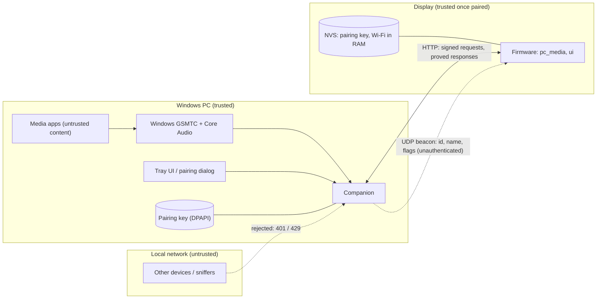

# Security

DeskMedia Display puts a small network service on a PC and a networked touchscreen next to it. This page states what is protected, from whom,
how, and what is deliberately **not** protected. The wire-level details of pairing and request authentication are in
[protocol.md](protocol.md); the pre-publication audit results are at the end.

## Summary

| Question | Answer |
|---|---|
| Who can control playback, seek, change volume or switch sources? | Only the one display that is **paired** with the companion (and processes on the PC itself). Every other LAN client gets `401`. |
| Is what I play visible to others on the network? | Not to other clients (`/now-playing`, artwork and the idle picture need a signature too). A passive sniffer on your LAN or Wi-Fi *can* read the traffic: the protocol is **authenticated but not encrypted** (no TLS). |
| Does anything need an internet connection or an account? | No. No Spotify OAuth, no cloud, no telemetry. The companion listens on the LAN only. |
| What secrets exist? | The pairing key (256 bit): in the companion's per-user data folder, protected with Windows DPAPI, and in the display's NVS. Wi-Fi credentials of the display (compile-time development configuration, see below). Nothing is in the repository. |
| Can I make the repository / firmware public safely? | The repository: yes (audit below). A **firmware image you built**: no, it contains your Wi-Fi credentials; share the source, not your binary. |

## Assets and attackers

Assets: control of the PC's media apps and their volume; privacy of what is playing; the pairing key; the display's Wi-Fi credentials;
the user's idle-screen picture and text.

| Attacker | Capability | Handled by |
|---|---|---|
| **Another device on the LAN** (guest, compromised IoT device) | connect to the companion, spoof beacons, replay captured requests, probe | private-client check, pairing, signed requests with single-use nonces, rate limiting, connection cap, bounded request parsing |
| **Passive listener** on the LAN / Wi-Fi | read all traffic | pairing is a key agreement (nothing reusable is sent); after pairing the key never crosses the network. **Metadata and artwork are visible** (limitation) |
| **Rogue host impersonating the PC** (spoofed beacon / ARP) | feed the display fake data or a crafted JPEG, harvest credentials | the display accepts only responses that carry a valid proof under the pairing key; nothing it sends reveals the key; it never pairs without a tap on its own screen |
| **A web page in the PC's browser** | cross-site / DNS-rebinding requests to the local service | IP-literal `Host` check, required `X-Desk-Client` header on every `POST` (forces a CORS pre-flight, which is never approved), no CORS headers, loopback is the only unauthenticated path |
| **Another process on the PC** | already runs as a Windows user | out of scope: it can use the same Windows media APIs directly; loopback requests are therefore not authenticated. DPAPI keeps the pairing file useless to other accounts |
| **Hostile media** (a page or app that publishes a malicious title / thumbnail) | crafted metadata and images reach the companion, then the display | image pixel / size caps and re-encoding on the PC; size-capped responses, bounded string copies and a baseline-JPEG-only decoder on the display |
| **Physical access to the display** | read flash / NVS over USB | **not handled**: flash encryption and NVS encryption are off (they need irreversible eFuse changes). Forget the pairing on the PC when you give the display away |
| Compromised PC (administrator), compromised router, nation-state | | out of scope |

## Trust boundaries

Everything crossing the LAN boundary is treated as hostile input on both sides.

## Pairing and request authentication

Full specification: [protocol.md](protocol.md). In short:

* **One display, one companion.** Pairing is opened deliberately on the PC (tray menu, 120 s window) and needs a person on **both** devices:
  the display and the PC each show the same 6-digit code, and the user taps **Pair** on the display and **Pair** on the PC.
* **Key agreement, not key transport.** Ephemeral X25519 with a commitment (the display commits to its nonce before it sees the companion's)
  and the 6-digit code derived from the shared secret: a man in the middle gets the two codes to match with probability 10^-6 per
  attempt, a passive listener learns nothing. The 256-bit key `K` is derived (HKDF-SHA-256) and **never sent**.
* **Signed requests.** Every request carries a single-use server nonce (60 s, 32 outstanding at most) and `HMAC-SHA-256(K, nonce, method, target)`;
  replays and tampered targets fail. Responses carry a proof over nonce, status and body hash, so the display rejects forged or modified answers.
* **Storage.** Companion: `%LOCALAPPDATA%\DeskMediaCompanion\pairing.dat`, DPAPI-protected (current Windows user only), atomic writes, never logged. Display: NVS.
* **Re-pair / reset.** "Forget paired display" in the tray revokes access immediately; a new pairing replaces the old one on both sides. A display that
  is not accepted any more (or has not heard from its PC for 120 s) offers to pair again, so no button gesture on the device is needed.
* **Defaults.** With no display paired, every LAN request (except `/hello`, `/health`, `/pair/*`) is refused. There is no "open" mode.

## LAN exposure

* The companion listens on `0.0.0.0:8765` (TCP) and broadcasts a beacon on UDP 8766. It serves only **private, link-local and loopback** client addresses; others get `403`.
  Windows Defender Firewall should allow the program on **Private networks only** (the first-run prompt: untick "Public networks").
* The beacon carries the PC name, a random companion id and two flags (`paired`, `pairing`) so that the display can find its PC. It is unauthenticated by design and is
  only used to *locate* a candidate; everything after that is authenticated.
* Do not forward port 8765 from your router and do not run the companion on an untrusted network (café, hotel, guest Wi-Fi).

## Input handling and resource limits

Companion: request line / header limits of the standard library, bodies on the pairing routes limited to 1 KB and refused elsewhere above 4 KB, `Content-Length` validated,
`/artwork` parameters clamped (`size` 16..600, `maxw` 16..800), at most 32 simultaneous connections, 30 s idle timeout, per-address failure rate limit (10 / min => 60 s block),
no static file serving (no path traversal surface), no `eval` / `shell=True` / `pickle`, debug routes only with `--dev-tools` and then still authenticated.
Images from media apps are limited to 16 MB and 36 megapixels before decoding, idle pictures to 25 MB / 89 megapixels and a 200 KB re-encoded baseline JPEG; the idle
settings are changeable only in-process (tray window), never over HTTP.

Display: every HTTP response is size-capped (16 KB JSON, 160 KB artwork, 300 KB idle picture), JSON is parsed with a length-checked parser, every string is copied into a bounded buffer,
beacons are validated (port range, hex id), the firmware only ever sends the documented commands, and a response without a valid proof is treated as a failure.

## Secrets and data in the repository

* No credentials, keys or tokens are committed; `.gitignore` blocks `.env*`, `secrets.*`, `*.local.*`, key / certificate files, pairing stores, flash dumps (`*.bin`), logs, build output and personal idle-screen assets.
* Development Wi-Fi credentials live in the git-ignored `firmware/secrets.local.h` and are compiled into **your** firmware image. There is no first-run provisioning portal yet.
* Logs never contain keys, nonces, proofs, pairing codes or Wi-Fi credentials.
* All committed images are synthetic.

## Known limitations

1. **No transport encryption.** Authenticated, replay-protected and tamper-evident, but readable by anyone who can sniff your LAN or Wi-Fi (titles, artwork). A trusted home network is assumed.
2. **No at-rest protection on the display.** Anyone with physical access can read the pairing key and the Wi-Fi credentials from flash. Enabling flash / NVS encryption is irreversible and not done.
3. **Loopback is trusted** (tray UI, PC-side tools). A malicious process running as the same user can already drive the media apps directly.
4. **Pairing prompts can be provoked.** A rogue host can make an unpaired (or lost) display *show* a pairing prompt; nothing is stored unless the user taps **Pair** on the display - and
   a prompt that nobody asked for is a reason to tap **Cancel**.
5. **Beacon disclosure.** The PC name and a random companion id are broadcast on the LAN.
6. **Rate limiting is per source address** and in memory; a flood of valid-looking traffic can still keep the companion busy (it is a hobby-grade service, not hardened against DoS).
7. **The companion runs with the user's privileges** and is a Python application bundled with PyInstaller; keep the dependencies updated (`pip-audit`).
8. Wi-Fi credentials are compile-time developer configuration (see above).

## Safe deployment guidance

* Use a home network you control; put guests on an isolated guest network.
* Allow the companion through the Windows firewall for **Private** networks only.
* Pair in private (nobody else should be tapping your display during the 2-minute window) and compare the two codes every time.
* Use "Forget paired display" before giving the display away or reinstalling the PC.
* Never publish a firmware image you built, a flash backup, `secrets.local.h` or the companion's data folder.
* Before pushing a fork: run a secret scanner (for example `gitleaks git`) over the whole history.

## Reporting a vulnerability

Please report suspected vulnerabilities privately through GitHub's "Report a vulnerability" (Security advisories) feature of this repository, not in a public issue.

## Pre-publication audit (record)

Performed on the full history (18 commits, every branch) before the project was prepared for publication:

| Check | Result |
|---|---|
| gitleaks 8.30.1 (full history) | 0 findings |
| TruffleHog 3.99.2 (full history, verification disabled so nothing is sent to any provider) | 0 findings |
| detect-secrets 1.5.0 (all tracked files) | 0 findings |
| Own full-history scanner (every blob version, commit message and file name: Wi-Fi names / passwords, API keys, tokens, private keys, certificates, `.env`, MAC addresses, private IPs, absolute paths, e-mail addresses) | no credential of any kind; low-severity personal context only (below) |
| Binary / image inventory | 7 images, all synthetic; no flash dump, `.bin`, certificate or font file ever committed |
| pip-audit (companion and tool requirements, pinned environment) | no known vulnerabilities |
| bandit (49 findings) | none is a vulnerability: SHA-1 used as a non-security id (`usedforsecurity=False`), the deliberate `0.0.0.0` bind (now covered by authentication), test-tool `urlopen` to loopback, `try/except/pass` in cleanup paths |

Result: **no credential had to be rotated** and none was ever exposed. Low-severity personal context found in the early history (a public commit e-mail address, the development
board's MAC address and private LAN addresses, project-brief wording) was removed from the current tree; it remains in older commits (see the maintainer notes in the release report).
