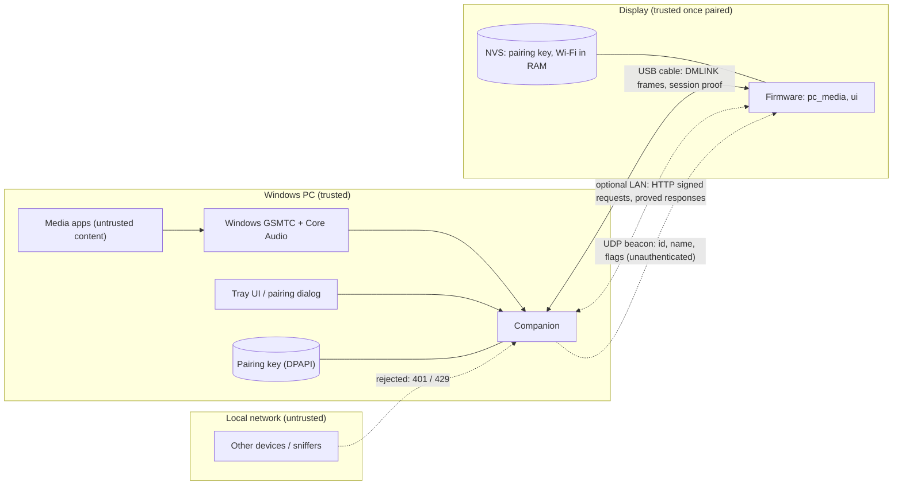

# Security

DeskMedia Display connects a touchscreen to a PC, by default with a **USB cable** (no network service at all) and optionally over the local
network. This page states what is protected, from whom, how, and what is deliberately **not** protected. The wire-level details of pairing and request
authentication are in [protocol.md](protocol.md), the USB link in [usb-protocol.md](usb-protocol.md); the audit records are at the end.

## Summary

| Question | Answer |
|---|---|
| Who can control playback, seek, change volume or switch sources? | Only the one display that is **paired** with the companion (and processes on the PC itself). Over USB a connection must first prove it holds the pairing key (a mutual challenge-response); every other LAN client gets `401`. |
| Is what I play visible to others on the network? | Not to other clients (`/now-playing`, artwork and the idle picture need a signature too). A passive sniffer on your LAN or Wi-Fi *can* read the traffic: the protocol is **authenticated but not encrypted** (no TLS). |
| Does anything need an internet connection or an account? | No. No Spotify OAuth, no cloud, no telemetry. **By default the companion opens no network port at all** (USB); the optional LAN mode listens on the LAN only. |
| What secrets exist? | The pairing key (256 bit): in the companion's per-user data folder, protected with Windows DPAPI, and in the display's NVS. The product firmware has no Wi-Fi credentials (the optional LAN fallback of a development build compiles them in, see below). Nothing is in the repository. |
| Can I make the repository / firmware public safely? | The repository: yes (audit below). A **firmware image you built**: no, it contains your Wi-Fi credentials; share the source, not your binary. |

## Assets and attackers

Assets: control of the PC's media apps and their volume; privacy of what is playing; the pairing key; the display's Wi-Fi credentials;
the user's idle-screen picture and text.

| Attacker | Capability | Handled by |
|---|---|---|
| **Another device on the LAN** (guest, compromised IoT device) | connect to the companion, spoof beacons, replay captured requests, probe | private-client check, pairing, signed requests with single-use nonces, rate limiting, connection cap, bounded request parsing |
| **Passive listener** on the LAN / Wi-Fi | read all traffic | pairing is a key agreement (nothing reusable is sent); after pairing the key never crosses the network. **Metadata and artwork are visible** (limitation) |
| **A program on the PC that holds the COM port, or a rogue USB device with the board's ids (303A:1001)** | impersonate a companion to the display, or a display to the companion; send malformed frames; make a pairing prompt appear on either side | the companion writes nothing to a port until a valid beacon arrived; private routes need the session proof; a pairing needs the code compared and a tap on the display and a click on the PC (the PC's **Pair** button arms 1.5 s after the code appears); the parsers are bounded and resynchronise ([usb-protocol.md](usb-protocol.md) section 9). Residual risk: a user who confirms a code without comparing it |
| **Rogue host impersonating the PC** (spoofed beacon / ARP) | feed the display fake data or a crafted JPEG, harvest credentials | the display accepts only responses that carry a valid proof under the pairing key; nothing it sends reveals the key; it never pairs without a tap on its own screen |
| **A web page in the PC's browser** | cross-site / DNS-rebinding requests to the local service | IP-literal `Host` check, required `X-Desk-Client` header on every `POST` (forces a CORS pre-flight, which is never approved), no CORS headers, loopback is the only unauthenticated path |
| **Another process on the PC** | already runs as a Windows user | out of scope: it can use the same Windows media APIs directly; loopback requests are therefore not authenticated. DPAPI keeps the pairing file useless to other accounts |
| **Hostile media** (a page or app that publishes a malicious title / thumbnail) | crafted metadata and images reach the companion, then the display | image pixel / size caps and re-encoding on the PC; size-capped responses, bounded string copies and a baseline-JPEG-only decoder on the display |
| **Physical access to the display** | read flash / NVS over USB | **not handled**: flash encryption and NVS encryption are off (they need irreversible eFuse changes). Forget the pairing on the PC when you give the display away |
| Compromised PC (administrator), compromised router, nation-state | | out of scope |

## Trust boundaries

Everything crossing the LAN boundary, and everything that arrives on the USB link, is treated as hostile input on both sides.

## Pairing and request authentication

Full specification: [protocol.md](protocol.md). In short:

* **One display, one companion.** Pairing is opened deliberately on the PC (tray menu, 120 s window) and needs a person on **both** devices:
  the display and the PC each show the same 6-digit code, and the user taps **Pair** on the display and **Pair** on the PC.
* **Key agreement, not key transport.** Ephemeral X25519 with a commitment (the display commits to its nonce before it sees the companion's)
  and the 6-digit code derived from the shared secret: a man in the middle gets the two codes to match with probability 10^-6 per
  attempt, a passive listener learns nothing. The 256-bit key `K` is derived (HKDF-SHA-256) and **never sent**.
* **Signed requests.** Every request carries a single-use server nonce (60 s, 32 outstanding at most) and `HMAC-SHA-256(K, nonce, method, target)`;
  replays and tampered targets fail. Responses carry a proof over nonce, status and body hash, so the display rejects forged or modified answers.
* **Storage.** Companion: `%LOCALAPPDATA%\DeskMediaCompanion\pairing.bin`, DPAPI-protected (current Windows user only), atomic writes, never logged. Display: NVS.
* **Re-pair / reset.** "Forget paired display" in the tray revokes access immediately; a new pairing replaces the old one on both sides. A display that
  is not accepted any more (or has not heard from its PC for 120 s) offers to pair again, so no button gesture on the device is needed.
* **Defaults.** With no display paired, every LAN request (except `/hello`, `/health`, `/pair/*`) is refused. There is no "open" mode.

## LAN exposure

* The companion listens on `0.0.0.0:8765` (TCP) and broadcasts a beacon on UDP 8766. It serves only **private, link-local and loopback** client addresses; others get `403`.
  Windows Defender Firewall should allow the program on **Private networks only** (the first-run prompt: untick "Public networks").
* The beacon carries the PC name, a random companion id and two flags (`paired`, `pairing`) so that the display can find its PC. It is unauthenticated by design and is
  only used to *locate* a candidate; everything after that is authenticated.
* Do not forward port 8765 from your router and do not run the companion on an untrusted network (café, hotel, guest Wi-Fi).

## USB link

The cable is a point-to-point link between this PC and the display, so the threats differ from the LAN's: there is no network attacker, but anything on
the PC that can open the COM port, and anything that can pretend to be the board, can talk to the other end. Full detail: [usb-protocol.md](usb-protocol.md).

* **Nothing is written to an unknown port.** The companion probes only ports of the board's USB ids, and a port counts as a display only after a valid,
  checksummed BEACON; before that the companion sends not one byte (so an unrelated device on a COM port is never disturbed).
* **A session per connection.** Pairing is unchanged (a six-digit code on both screens, a click on the PC and a tap on the display). Each USB connection
  then starts with `/link/open` and `/link/auth`, a mutual HMAC-SHA-256 challenge-response over the pairing key with fresh nonces on both sides, bound to
  both identities. Before that only `/hello`, `/health`, `/pair/*` and `/link/*` are served; a bad proof is `401`, ten failures a minute block the handshake
  for a minute. The session ends when the link closes, the display restarts (a new boot id), or the pairing is forgotten or replaced; a proof-less
  `/link/open` does not end a live session, and a remembered answer is not replayed to a link whose session has ended.
* **Not encrypted, no per-frame MAC.** After the session opens, the cable carries now-playing data in clear and frames are protected against damage (CRC-16 and
  CRC-32), not against forgery. An attacker who can rewrite the cable has physical access and is out of scope.
* **Bounded on both ends.** Frame payload 4096 bytes; requests 4096, targets 512; the companion's receive buffer 64 KB; responses checked against their announced
  size and per-route limits (16 KB JSON, 160 KB cover, 300 KB idle picture); a stalled partial frame is dropped after 1 s; the display's parser throws its input
  away for half a second when it sees a burst of damaged frames (protection against a stream of crafted headers); cJSON's nesting limit is 8 levels on the
  display (its default of 1000 would overflow a task stack); an artwork JPEG larger than the decode buffers is refused after the scale-down loop.
* **Nothing from a peer is executed or used as a path.** No frame can make either side write a file, run a command or open a location; the tray shows only fixed
  text plus a cleaned firmware string, a short device id and the port name; the QR code on the display carries a compile-time URL.
* **Development features cannot be reached in a product build.** DEBUG frames, screenshots, scripted touches, `reboot` and `usb_replug_*` exist only with
  `APP_DEV_TOOLS` (`tools/package_firmware.ps1` refuses an image that contains them); in the companion `/debug/*` exists only with `--dev-tools`. Product firmware
  mirrors only warnings and errors of its log, which the companion keeps at warning level unless started with `--debug`.
* **No firewall involvement.** In USB mode the companion listens on nothing; the installer changes no firewall, Defender or security setting.

## Input handling and resource limits

Companion: request line / header limits of the standard library, bodies on the pairing routes limited to 1 KB and refused elsewhere above 4 KB, `Content-Length` validated,
`/artwork` parameters clamped (`size` 16..600, `maxw` 16..800), at most 32 simultaneous connections, 30 s idle timeout, per-address failure rate limit (10 / min => 60 s block),
no static file serving (no path traversal surface), no `eval` / `shell=True` / `pickle`, debug routes only with `--dev-tools` and then still authenticated.
Images from media apps are limited to 16 MB and 36 megapixels before decoding, idle pictures to 25 MB / 89 megapixels and a 200 KB re-encoded baseline JPEG; the idle
settings are changeable only in-process (tray window), never over HTTP.

Display: every HTTP response is size-capped (16 KB JSON, 160 KB artwork, 300 KB idle picture), JSON is parsed with a length-checked parser, every string is copied into a bounded buffer,
beacons are validated (port range, hex id), the firmware only ever sends the documented commands, and a response without a valid proof is treated as a failure.

## Secrets and data in the repository

* No credentials, keys or tokens are committed; `.gitignore` blocks `.env*`, `secrets.*`, `*.local.*`, key / certificate files, pairing stores, flash dumps (`*.bin`), logs, build output and personal idle-screen assets.
* Development Wi-Fi credentials live in the git-ignored `firmware/secrets.local.h` and are compiled into **your** firmware image. There is no first-run provisioning portal yet.
* Logs never contain keys, nonces, proofs, pairing codes or Wi-Fi credentials.
* All committed images are synthetic.

## Known limitations

1. **No transport encryption.** Authenticated, replay-protected and tamper-evident, but readable by anyone who can sniff your LAN or Wi-Fi (titles, artwork). A trusted home network is assumed.
2. **No at-rest protection on the display.** Anyone with physical access can read the pairing key and the Wi-Fi credentials from flash. Enabling flash / NVS encryption is irreversible and not done.
3. **Loopback is trusted** (tray UI, PC-side tools). A malicious process running as the same user can already drive the media apps directly.
4. **Pairing prompts can be provoked.** A rogue host can make an unpaired (or lost) display *show* a pairing prompt; nothing is stored unless the user taps **Pair** on the display - and
   a prompt that nobody asked for is a reason to tap **Cancel**.
5. **Beacon disclosure.** The PC name and a random companion id are broadcast on the LAN.
6. **Rate limiting is per source address** and in memory; a flood of valid-looking traffic can still keep the companion busy (it is a hobby-grade service, not hardened against DoS).
7. **The companion runs with the user's privileges** and is a Python application bundled with PyInstaller; keep the dependencies updated (`pip-audit`).
8. Wi-Fi credentials are compile-time developer configuration (see above); the product firmware has none.
9. **USB: confirming without comparing.** A rogue device (or a program that holds the port) can make a pairing prompt appear on the PC (while nothing is paired) or on a
   display. The defence is the comparison of the two codes by a person, as for any pairing by a short code; the dialog says so and arms its button after 1.5 s.
   The USB link has no per-frame MAC and is not encrypted (see above). Only the first display that beacons is served; a second one is ignored until the first is gone.
10. **Same-user and local-tool access.** Another process of the same Windows user can read the DPAPI-protected `pairing.bin` (the entropy is a constant) and use the COM port
   when the companion is not running; the board's USB-Serial/JTAG function lets local tools read its flash (the pairing key included). Both are consistent with the
   "another process on the PC" and "physical access" rows above.
11. **The installer is not code-signed**, so Windows SmartScreen asks once; `/DIR=` accepts any folder the user can write; a process in the same Windows session can occupy the single-instance mutex name.

## Safe deployment guidance

* Use a home network you control; put guests on an isolated guest network.
* Allow the companion through the Windows firewall for **Private** networks only.
* Pair in private (nobody else should be tapping your display during the 2-minute window) and compare the two codes every time.
* Use "Forget paired display" before giving the display away or reinstalling the PC.
* Never publish a firmware image you built, a flash backup, `secrets.local.h` or the companion's data folder.
* Before pushing a fork: run a secret scanner (for example `gitleaks git`) over the whole history.

## Reporting a vulnerability

Please report suspected vulnerabilities privately through GitHub's "Report a vulnerability" (Security advisories) feature of this repository, not in a public issue.

## Pre-publication audit (record)

Performed on the full history (18 commits, every branch) before the project was prepared for publication:

| Check | Result |
|---|---|
| gitleaks 8.30.1 (full history) | 0 findings |
| TruffleHog 3.99.2 (full history, verification disabled so nothing is sent to any provider) | 0 findings |
| detect-secrets 1.5.0 (all tracked files) | 0 findings |
| Own full-history scanner (every blob version, commit message and file name: Wi-Fi names / passwords, API keys, tokens, private keys, certificates, `.env`, MAC addresses, private IPs, absolute paths, e-mail addresses) | no credential of any kind; low-severity personal context only (below) |
| Binary / image inventory | 7 images, all synthetic; no flash dump, `.bin`, certificate or font file ever committed |
| pip-audit (companion and tool requirements, pinned environment) | no known vulnerabilities |
| bandit 1.9.4 | on the first (pre-pairing) tree: 3 High (SHA-1 / MD5 used as non-security ids), 15 Medium (the deliberate `0.0.0.0` bind, `urlopen` to loopback in tools), 31 Low. Now: **0 High; the production package `companion/desk_media_companion` has 0 Medium and 2 Low** (`try/except/pass` in cleanup paths); the remaining Medium findings are in development tools (`urlopen` on fixed loopback URLs, the deliberate rogue server of `tools/pairing_test.py`) |
| gitleaks (final tree, full history, with `.gitleaks.toml`) | no leaks; the allowlist covers one published protocol test vector |

Result: **no credential had to be rotated** and none was ever exposed. Low-severity personal context found in the early history (a public commit e-mail address, the development
board's MAC address and private LAN addresses, project-brief wording) was removed from the current tree; it remains in older commits of the history, which has not been rewritten.

## Post-change security review: the USB-first release (record, 2026-10-14)

An independent read-only review (a separate agent with the repository, a fuzzer for the Python frame parser and the API, and a simulator of the display; no board,
no port, nothing flashed) plus the project's scanners, run on the branch `feature/usb-first-onboarding`.

| Check | Result |
|---|---|
| gitleaks 8.30.1, full history of every branch (56 commits) | no leaks |
| bandit 1.9.4 on `companion/desk_media_companion` | 0 High, 0 Medium, 8 Low (`try / except / pass` in cleanup paths) |
| pip-audit on the pinned companion environment (23 packages) | no known vulnerabilities |
| Fuzzing the Python `FrameParser` (20,000 random and structured inputs, 34 MB) and `Api.handle` (150,000 random targets and bodies) | 0 exceptions; the parser buffer never exceeded 4111 bytes and an intact frame was always recovered |
| 6,000 injections into a live link with the simulated display | 0 exceptions, the link stayed up |

Findings and what was done (the reviewer's severities):

| # | Finding | Severity | Disposition |
|---|---|---|---|
| 1 | cJSON's default nesting limit (1000, about 64 KB of stack) against 4 KB / 12 KB task stacks: a peer sending `[[[[...` could crash or corrupt the display | High | **Fixed**: `CJSON_NESTING_LIMIT=8` for the whole firmware; the on-target self-test checks that deep nesting is refused and ordinary JSON still parses |
| 2 | Artwork JPEG of 65535 x 8 passes the byte-count check at 1/8 scale (8192 x 1) and overruns a 432-byte work buffer | Medium | **Fixed**: width and height are re-checked against the buffer limits after the scale loop |
| 3 | A program holding the COM port can answer as a companion that "forgot" the pairing; a tap on the unrequested prompt replaces the key | Medium | **Mitigated**: the prompt now says "No matching code on your PC? Tap Cancel"; the protocol document no longer claims a tap is not enough. Residual risk: a user who taps without comparing |
| 4 | A rogue 303A:1001 device can lure one careless click on a PC that has no paired display | Medium | **Mitigated**: the **Pair** button arms 1.5 s after the code appears; `/pair/offer` must name the display that beacons on that cable. Residual risk as above |
| 5 | The first beaconing device is served; a paired display plugged in second waits | Low | Documented limitation |
| 6 | The duplicate-request memory could replay a private answer after "Forget paired display" | Low | **Fixed**, with a test |
| 7 | A proof-less `/link/open` revoked a live session | Low | **Fixed**: the session is replaced only when `/link/auth` succeeds; tests updated |
| 8 | The log mirror sent every level and the companion logged track titles at INFO, against the documentation | Low | **Fixed**: product firmware mirrors warnings and errors only; the companion's default sink keeps warnings and errors, and the track title is logged at DEBUG |
| 9 | A stream of valid-looking headers (4096-byte claims, 12 bytes apart) costs one 4 KB CRC per 12 input bytes and could starve the other tasks | Low | **Fixed**: a burst of damaged frames makes the receiver ignore its input for 500 ms. Not measured under load on the board |
| 10 | The pairing window is shared by the two transports | Low | Documented (LAN is off by default) |
| - | `/pair/offer` did not bind `dev` to the beacon | Info | **Fixed** (see 4) |
| - | `idle_screen`: a failed LVGL lock left the old picture buffer freed while displayed | Info | **Fixed**: the buffer is kept (a small leak) instead |
| - | Out-of-range double-to-integer casts of JSON numbers (undefined behaviour) | Info | **Fixed**: clamped |
| - | Constant DPAPI entropy; flash readable through USB-Serial/JTAG; unsigned installer; `/DIR=`; mutex squatting; fixed `%TEMP%` result file names; per-link failure limiter resets on reconnect | Info | Documented (limitations 10 and 11), consistent with the threat model |

Not verified: the behaviour of the stack and heap findings on the real board (the fixes remove the conditions; the on-target self-test covers the JSON limit), parser load
under attack on the target, COM-port access control for other Windows users, a real installer run on a clean machine, and the LAN-mode firmware after these changes.
